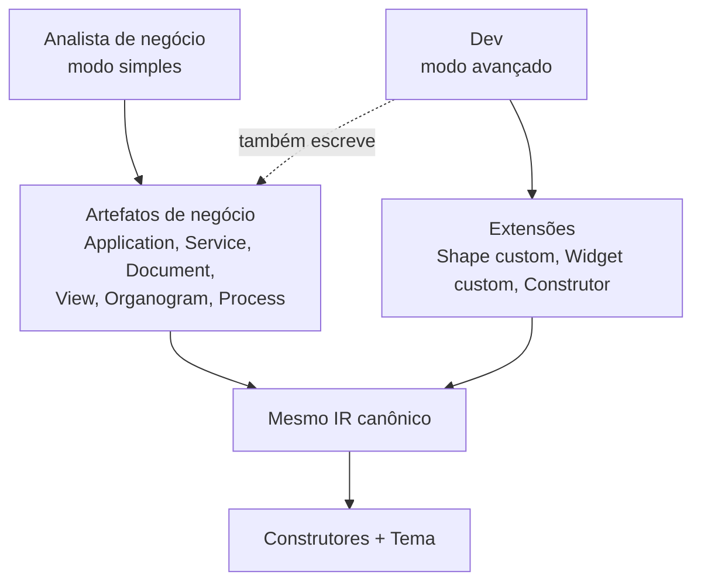
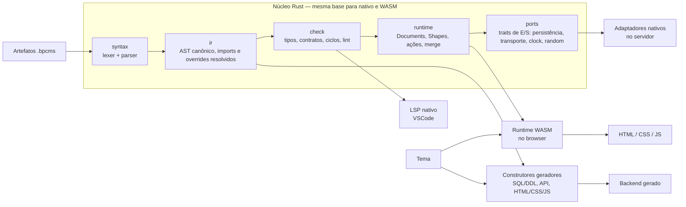
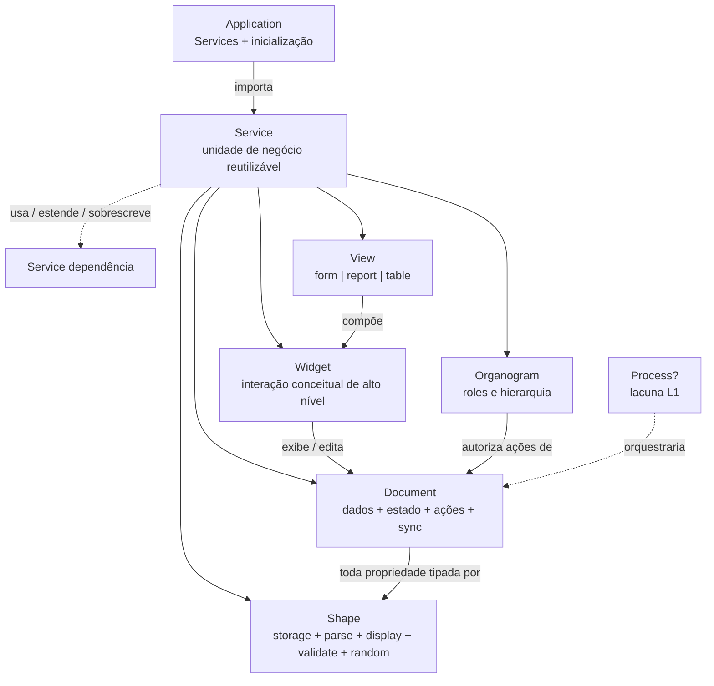
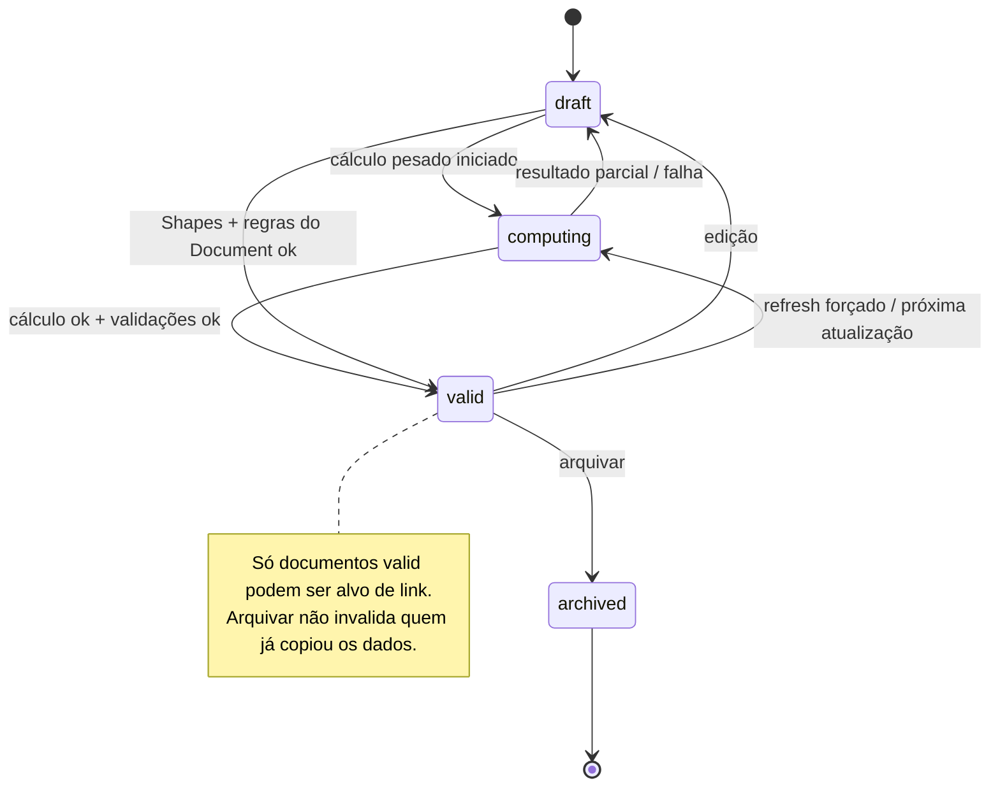
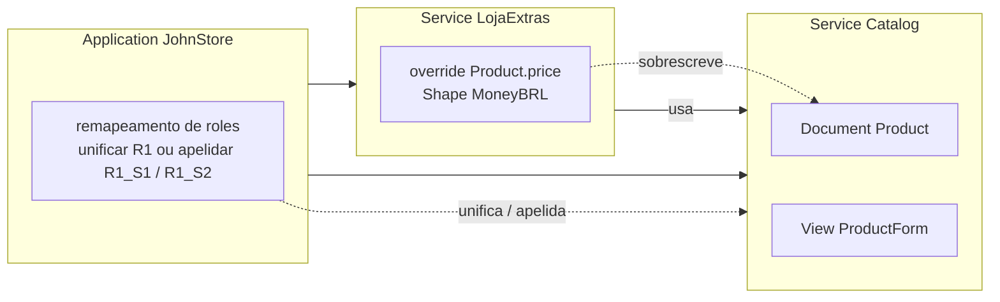

# BPCMS — Brainstorm

*Documento vivo.* Nada aqui é especificação fechada: é material para explorar possibilidades, escolher e descartar.  
Atualizado a cada rodada de entrevista. Última atualização: 2026-11-14 — *Rodada 1 respondida, Rodada 2 enviada.*

## Legenda de status
| Marca | Significado |
| :--- | :--- |
| ✅ | Decidido pelo autor do projeto |
| 🔶 | Proposta minha (aguardando confirmação) |
| ❓ | Pergunta aberta / lacuna |
| 🧊 | Congelado de propósito (decidir depois) |

## Como ler (níveis de detalhe)
| Nível | Conteúdo | Para quem |
| :--- | :--- | :--- |
| 0 | Pitch de 1 parágrafo | qualquer pessoa, 30s |
| 1 | Visão, fronteiras, princípios, personas | decisor |
| 2 | Arquitetura conceitual + diagramas | arquiteto |
| 3 | Artefatos em detalhe (campos, exemplos) | quem implementa o núcleo |
| 4 | Trade-offs e problemas duros | quem implementa construtores |
| — | Lacunas, decisões, fila de entrevista | nós dois, agora |

---

## Nível 0 — Pitch

BPCMS é uma ferramenta que unifica **BPM + CMS + SOA**: você declara o negócio em artefatos (`application`, `service`, `shape`, `widget`, `document`, `view`, `organogram`) numa linguagem própria parecida com TypeScript, e **construtores** transformam esses artefatos em software real — web, desktop, mobile, terminal, backend — sem reescrever a lógica. A lógica de negócio vive uma única vez, no artefato; a plataforma é um detalhe de geração.

---

## Nível 1 — Visão e fronteiras

### 1.1 A mescla (o que cada sigla contribui)
| Sigla | O que entra no BPCMS | Artefato(s) que carregam isso |
| :--- | :--- | :--- |
| **BPM** | processos, papéis, autorização, tarefas manuais e automatizadas | `Organogram`, ❓ `Process` (lacuna L1), `Document.ações` |
| **CMS** | conteúdo/estrutura, apresentação, themes, i18n | `View`, `Widget`, `Theme`, `Shape` (display) |
| **SOA** | serviços reutilizáveis, contratos, composição e substituição | `Service`, `Application`, construtores como ports |

### 1.2 Princípios não-negociáveis ✅
* **SOLID + clean code** rígidos em todo o projeto (núcleo, DSL, LSP, construtores).
* Arquitetura **inspirada** em Clean Architecture, com **nomes e artefatos próprios**.
* **Regra de ouro:** lógica de negócio nunca na `Application`; vive em artefatos dentro de um `Service`.
* **Corolário 🔶:** construtor também **não** contém regra de negócio — só realiza intenção.
* **Independência de plataforma no nível conceitual:** artefato declara intenção, construtor decide realização.

### 1.3 Fronteiras (🔶 confirmar)
| É | Não é (por enquanto) |
| :--- | :--- |
| Linguagem + tooling (LSP/VSCode) + núcleo de artefatos + construtores | IDE visual no-code completa |
| Framework de definição de negócio orientado a artefatos | Mais um ORM / mais um UI kit |
| Multiplataforma por geração + interpretação | Todas as plataformas na v1 |
| Documento como unidade de verdade sincronizável | Ser um banco de dados |

### 1.4 Dois níveis de autoria ✅ (R1-Q2)
O **analista de negócio** declara o negócio; o **dev** estende a plataforma. Mesma linguagem, dois modos.

| | Analista (modo simples) | Dev (modo avançado) |
| :--- | :--- | :--- |
| **Escreve** | `Application`, `Service`, `Document`, `View`, `Organogram`, `Process` | `Shape` custom, `Widget` custom, Construtor, integrações |
| **Sintaxe** | declarativa, vocabulário de negócio, **sem expressões livres** 🔶 | tipos, expressões, código de extensão (❓ R2-Q4) |
| **LSP fala** | linguagem de negócio + sugestão de correção | tipos, contratos, violações de SOLID |
| **Ferramenta** | editor guiado + preview 🔶 | VSCode + CLI + testes |
| **Pode** | compor e parametrizar o que existe | criar novas primitivas |
| **Não pode** | furar a camada de negócio com código | embutir regra de negócio no construtor |

> ❓ **Como garantir a fronteira na prática:** modo simples é um *subconjunto validado da mesma DSL* ou uma *sintaxe separada*? (Rodada 4)

### 1.5 Stack ✅ (R1-Q4)
**Núcleo em Rust**, distribuído como **binário nativo** (LSP, CLI, servidor) e **WebAssembly** (runtime no browser). Alvo de apresentação: **HTML / CSS / JS**. Ganhos imediatos:
* **Uma única implementação de Shape/validação/merge** roda no editor, no browser e no servidor → semântica idêntica nos três lugares.
* O parser do LSP é o mesmo parser do runtime → zero divergência de interpretação.
* Performance para merge, cálculo de documentos derivados e validação em massa.

---

## Nível 2 — Arquitetura conceitual

### 2.1 Camadas com nomes próprios 🔶
| Camada | Responsabilidade | Realização em Rust |
| :--- | :--- | :--- |
| **Declaração** | artefatos `.bpcms` | texto fonte |
| **Núcleo** | parser → IR → checagem → execução | crates `syntax`, `ir`, `check`, `runtime` |
| **Contrato de Construção** | o que todo construtor deve implementar | `trait` (port) + capabilities |
| **Construtores** | gerar ou executar numa plataforma | crates `gen-*`, `web`, futuramente nativos |
| **Tema** | tokens, cores, ícones, opções | artefato consumido por construtores |

*SOLID aqui:* 1 crate = 1 responsabilidade (SRP); construtor novo não altera o núcleo (OCP); artefato sobrescrito respeita o contrato do original (LSP); ports pequenos e específicos (ISP); núcleo depende de traits, nunca de banco/DOM (DIP).  
🧊 *nomes alternativos:* Kernel, Port, Builder, Renderer.

### 2.2 Pipeline e alvos (Rust + WASM)

> ❓ Construtores de terceiros são crates compilados juntos, ou **plugins WASM** (component model) carregados em runtime? (Rodada 4)

### 2.3 Mapa de artefatos

### 2.4 Ciclo de vida do Document ✅

> ❓ Faltam `invalid`, `stale` (vencido), `conflict` (merge pendente), `deleted` (tombstone)? (Rodada 3)

### 2.5 Composição, override e remapeamento de roles

> ❓ **R2-Q3:** merge profundo por caminho, herança explícita com `override`, ou overlay/patch? Pode trocar o Shape de uma propriedade? Pode remover propriedade? Como o check garante LSP (não quebrar quem usa o original)? Versionar `Catalog@1.2`?

---

## Rodadas de Entrevista e Perguntas Pendentes

* **Rodada 3 — prevista:** Document, sync e conflitos (Identidade/versão, autoridade da verdade, ambientes, estratégia de merge, editor de conflitos, cache/event stream, documentos calculados, estados extras).
* **Rodada 4 — prevista:** DSL, LSP e construtores (Gramática mínima, modo simples × avançado, formato e versão do IR, capabilities de construtor, plugins WASM, Tema, testes).
* **Rodada 5 — prevista:** Fechamento (Artefatos restantes: `Job`/`Task`/`Integration`/`Policy`/`Locale`/`Environment`, governança e versionamento — só então retomar D-013 MVP).

---

## Glossário rápido
| Termo | Significado operacional |
| :--- | :--- |
| **Artefato** | unidade declarativa de negócio |
| **Construtor** | plugin que gera ou executa artefatos |
| **Service** | encapsulamento de negócio reutilizável |
| **Application** | ponto de montagem voltado ao usuário final |
| **IR (Intermediate Representation)** | árvore canônica resolvida pelo núcleo Rust |
