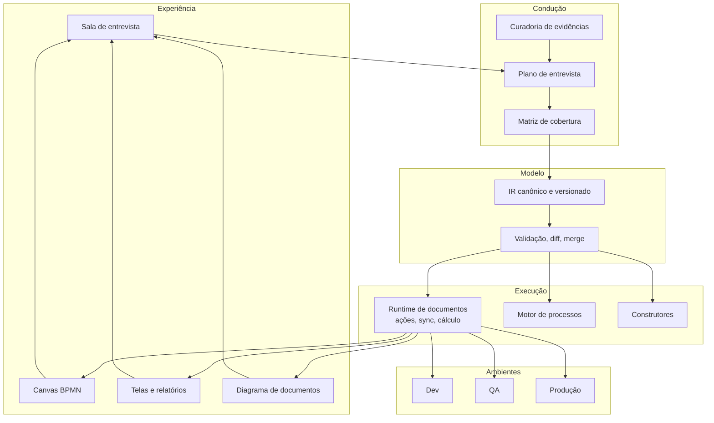
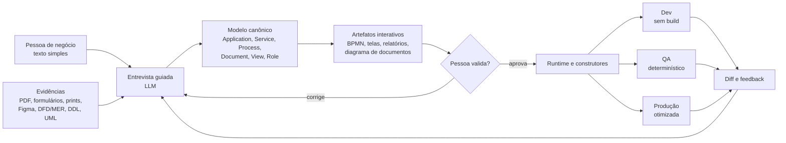
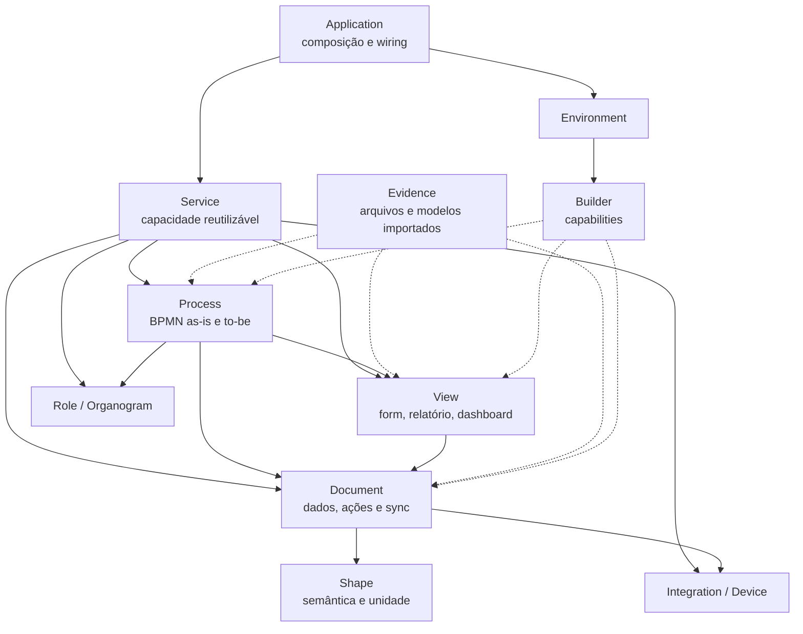
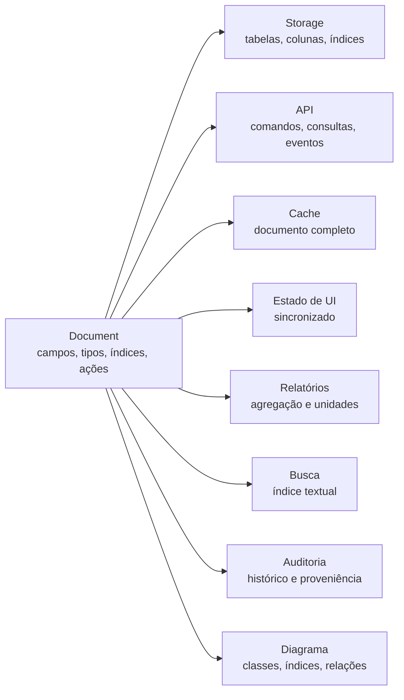
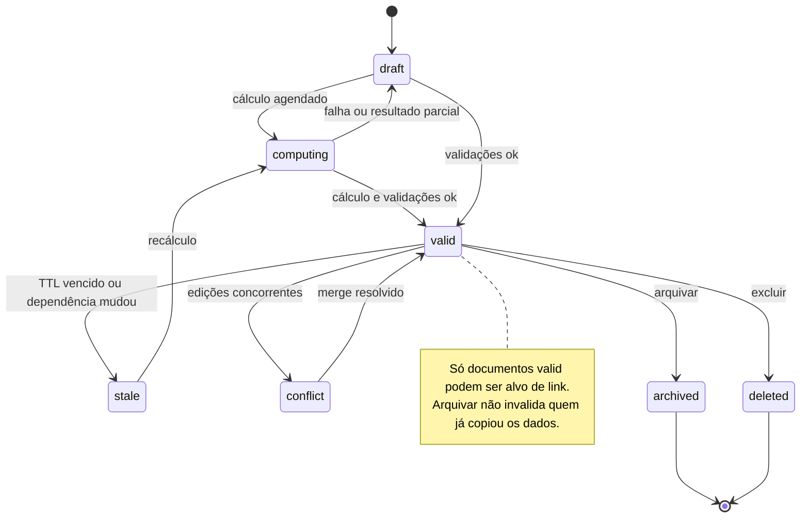
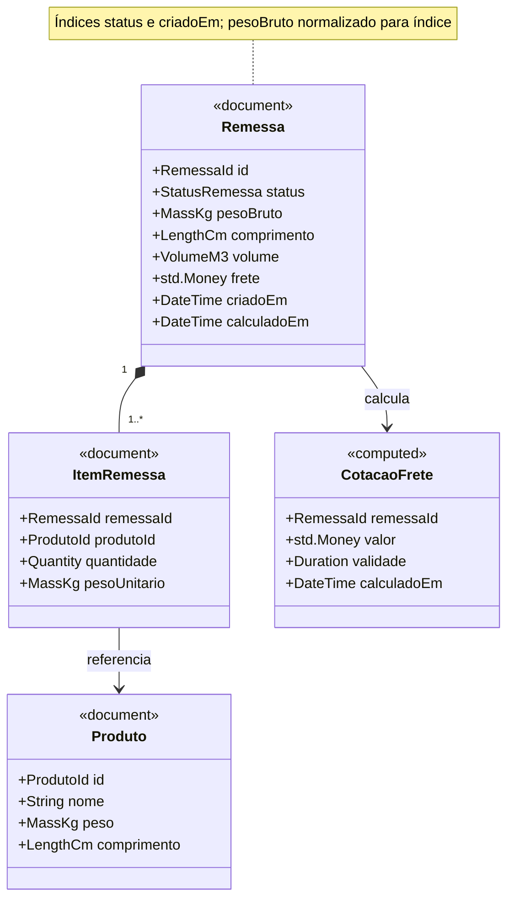
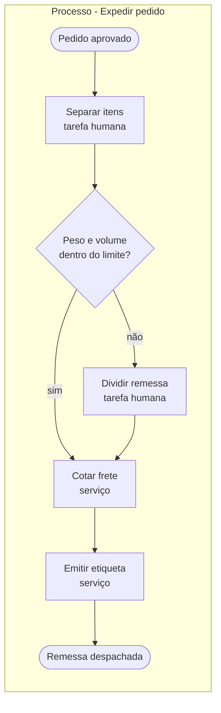
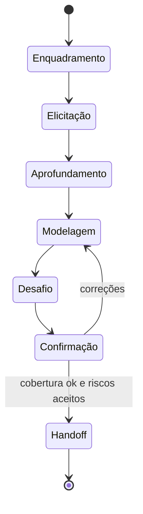
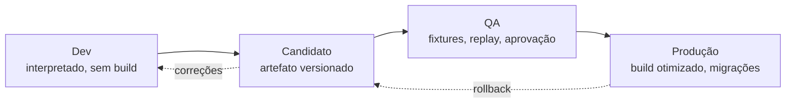

# BPCMS — Brainstorm

*Documento vivo.* As decisões de baseline estão fechadas; o detalhe de implementação evolui por versão.
Última atualização: **2026-11-13 — Rodada 4: baseline decisória v1, sem perguntas abertas, pronta para PRD/SPECS/PLAN.**

> **O que mudou nesta rodada.** As perguntas de desenho foram fechadas. O documento agora tem uma **baseline v1**: cada decisão tem um default, uma razão e, quando ainda há incerteza real, um **experimento com critério de sucesso**. Não há mais “a decidir”: há decisões tomadas (✅), defaults vetáveis (🔶), hipóteses testáveis (🔬) e itens fora de escopo (🧊). O objetivo é destravar a transformação em **PRD.md + SPECS.md + PLAN.md**.

### Resumo da baseline v1

| Dimensão | Decisão |
| :--- | :--- |
| **Produto** | BPCMS = BPM + SOA + CMS, com a LLM como porta de entrada: conversa → modelo → BPMN, telas e documentos → runtime. |
| **Fronteira** | `Application` não declara artefatos; todo artefato vive em `Service`. A app compõe, configura e inicializa parâmetros. |
| **V1** | Web, monólito modular, núcleo Rust + estúdio TS, BPMN subset, Document/Shape/unidades, read/live, dev interpretado. |
| **Identidade** | Application e Service têm URI web sem protocolo; registry: `/index.html` (download/docs); repositório Git: README + código baixado do projeto; versão por semver/tag/commit. |
| **Lock/IDs** | Um lock por app: uma versão por serviço + ID estável para cada identificador; usado para minificação e compressão. Serviço não tem lock/IDs/versões de imports. |
| **Contrato do serviço** | Todo artefato de topo é público; não há `exports`. `private` só em membros internos (campos/ações). |
| **Capabilities** | Conceitos de alto nível (`gui`, `tui`, `print`, `oltp`, `sync`, `location`, `identity`, `scheduling`, `attachments`, `capture`, `notify`); tecnologia é detalhe do construtor. |
| **Essenciais** | `location`, `timezone`, `regionalization` e `units` são capabilities de plataforma; `units` oferece Shapes métrico/imperial e conversões. |
| **Título** | `title` é `I18n` em artifacts e fields; suporta `short`/`tooltip`; locales definem chaves/default; prod estrito, dev pode fallback/editar. |
| **ID/Lookup** | Document tem id implícito; `lookup` é copiado em toda referência; FK inexistente bloqueia novos vínculos; projeção puxa campos. |
| **Extensão** | `Consumer extends User` compartilha `UserId`, herda lookup e adiciona `citizenId`; `ConsumerId` é alias de `UserId`. |
| **Enums/Ícones** | Todo value de enum tem `title` I18n + `icon` + `ordinal` (10, 20, 30...); `Icon` é token semântico e o Theme/builder resolve a imagem. |
| **Citizen** | Serviço de identificação de pessoa/organização; `CitizenId` + lookup seguro; PII em `private`; sem `taxId`. |
| **Citizen 1:N** | Um Citizen pode ter vários Users; cada Consumer referencia o mesmo `citizenId`; sem unique; merge reatribui. |
| **Serviço** | Conceito de negócio, não package/módulo; tipos compartilhados ficam no serviço dono; Theme/Locale são do construtor. |
| **Nomes** | Sem repetir o serviço no nome (`Draft`, não `BillingDraft`); escopo é o serviço; sem duplicidade dentro do mesmo tipo/serviço. |
| **Stdlib** | `bpcms.org/std` é pseudo-serviço do construtor; import + alias; `std.Mass` etc.; sem lock. |
| **Parameter** | Configuração/segredo tipados, sempre dentro de um `Service`; `source: config \| secret`; valor nunca no lock. |
| **Compensação** | Task `type: compensation` com `for` e `action`; disparo por erro/cancelamento, ordem reversa, idempotência. |
| **Usuário** | Dono do processo conversa e valida; analista revisa; dev estende; QA aprova release. |
| **Documento** | Dados + ações + regras + sync + ciclo de vida; `Shape` é dono da semântica; unidade original + projeção + snapshot. |
| **Processo** | As-is primeiro; to-be como versão comparável; BPMN interativo/simulável; manual executável antes de automação. |
| **Ambientes** | Dev sem build; QA determinístico; produção otimizada; mesmo artefato promovido. |
| **Fora de escopo** | Marketplace, multi-plataforma, CRDT/offline, process mining, BPMN 2.0 completo. |
| **Próximo passo** | Gerar PRD.md, SPECS.md e PLAN.md sem reabrir o escopo. |

## Legenda de status

| Marca | Significado |
| :--- | :--- |
| ✅ | Decidido e assumido na baseline |
| 🔶 | Default de baseline — pode ser vetado, mas não bloqueia |
| 🔬 | Hipótese com experimento e critério de sucesso |
| 🧊 | Fora de escopo da v1 (com gatilho para revisitar) |
| ❌ | Descartado com razão |

## Como ler (níveis de detalhe)

| Nível | Conteúdo | Para quem |
| :--- | :--- | :--- |
| 0 | Pitch de 1 parágrafo | qualquer pessoa, 30s |
| 1 | Visão, fronteiras, princípios, personas | decisor |
| 2 | Arquitetura conceitual + diagramas | arquiteto |
| 3 | Artefatos em detalhe (campos, exemplos) | quem implementa o núcleo |
| 4 | Trade-offs e problemas duros | quem implementa construtores |
| 5 | MVP, roadmap, métricas, riscos | quem vai executar |
| — | Baseline, experimentos e handoff | nós dois, agora |

## Mapa do documento

| Seção | O que responde |
| :--- | :--- |
| Nível 0 | Qual é a ideia em 1 parágrafo |
| Nível 1 | Por que existe, para quem, o que entra e o que não entra |
| Nível 2 | Como as peças se encaixam (LLM, BPMN, documentos, ambientes) |
| Nível 3 | Como um artefato é definido em detalhe |
| Nível 4 | O que é difícil e quais são as alternativas |
| Nível 5 | Por onde começar e como medir |
| Baseline / Experimentos | O que está decidido, o que é hipótese e como validar |
| Handoff | Como este documento vira PRD, SPECS e PLAN |

---

## Nível 0 — Pitch

**BPCMS transforma a forma como uma área trabalha em software que roda — e continua evoluindo.**

A pessoa conta o processo em texto simples. Uma LLM entrevista, pede exemplos, lê evidências (formulários, PDFs, screenshots, rascunhos à mão, Figma, DFD/MER, DDL/SQL, diagramas UML, planilhas) e propõe um modelo de processo, documentos, papéis e telas. O modelo é devolvido em **artefatos interativos**: um BPMN navegável e simulável, protótipos clicáveis, relatórios/dashboards e um **diagrama de documentos** parecido com um diagrama de classes.

Por baixo, o BPCMS é a mescla de **BPM + SOA + CMS**: processos e papéis; serviços reutilizáveis com contratos; conteúdo, telas e apresentação. O modelo é a verdade. O runtime executa. Os **construtores** realizam o mesmo modelo em cada plataforma. **Dev roda sem build; QA é determinístico; produção é otimizada.**

> **Frase de trabalho:** “Do relato ao processo que roda, sem reescrever a lógica a cada plataforma.”

---

## Nível 1 — Visão e fronteiras

### 1.1 O problema que estamos resolvendo

Hoje, o conhecimento de um processo vive espalhado:

* na cabeça das pessoas que executam o processo;
* em documentos, planilhas, PDFs e telas antigas;
* em ferramentas de BPMN que exigem especialista e produzem diagramas que ninguém executa;
* em ferramentas low-code que geram aplicativos, mas não entendem o negócio;
* em LLMs que até entrevistam, mas devolvem texto solto, código frágil ou um diagrama que não vira sistema.

O BPCMS fecha o ciclo **entendimento → modelo → protótipo → execução → evolução**. A LLM não é o produto; é a **porta de entrada** para um modelo estruturado, validável e executável.

### 1.2 A mescla (o que cada sigla contribui)

| Sigla | O que entra no BPCMS | Artefatos que carregam isso |
| :--- | :--- | :--- |
| **BPM** | processos as-is e to-be, papéis, tarefas humanas e automáticas, decisões, prazos, simulação, execução, auditoria | `Process` (BPMN), `Role`/`Organogram`, `Task`, `Rule`, `Event` |
| **SOA** | serviços reutilizáveis, contratos, composição, substituição, propriedade de dados, capacidades | `Service`, `Application`, `Builder`, `Integration` |
| **CMS** | conteúdo, estrutura, formulários, relatórios, temas, idiomas, acessibilidade | `View`, `Widget`, `Theme`, `Locale`, `Document` (conteúdo estruturado) |
| **Descoberta (LLM)** | entrevista, evidências, propósito de cada informação, controle de complexidade, proposta de modelo | `Conversation`, `Evidence`, `Decision`, `Assumption` |

> A LLM não é um quarto silo. É a camada que alimenta os três. O produto continua sendo BPM + SOA + CMS; a diferença é **como** o modelo é descoberto e mantido.

### 1.3 Princípios não-negociáveis ✅

* **SOLID + clean code** rígidos em todo o projeto (núcleo, DSL, LSP, runtime, construtores).
* Arquitetura **inspirada** em Clean Architecture, com **nomes e artefatos próprios**.
* **Regra de ouro:** lógica de negócio nunca na `Application`; vive em artefatos dentro de um `Service`.
* **Corolário 🔶:** construtor também **não** contém regra de negócio — só realiza intenção.
* **Independência de plataforma no nível conceitual:** artefato declara intenção, construtor decide realização.

Princípios novos desta rodada:

* **O modelo é a verdade.** A conversa é entrada; o BPMN, a DSL e as telas são **visões** do mesmo modelo. Nada de “o desenho é uma coisa e o sistema é outra”.
* **Toda informação tem um propósito.** Campo, passo, exceção, integração ou relatório precisam apontar para uma decisão, ação, obrigação ou meta. Sem propósito, é candidato a remoção.
* **Evidência antes de suposição.** Se existe um formulário, um PDF, um DDL ou um print, a LLM deve extrair e confirmar — não perguntar do zero nem inventar.
* **Suposição explícita.** Toda inferência entra num registro de suposições, com impacto e forma de validação. Nada de decisão silenciosa.
* **Complexidade é custo.** Cada processo tem um orçamento de complexidade; a solução mais simples que atinge o objetivo vence.
* **Dev não tem build/deploy.** Build é otimização de produção, não pré-requisito para desenvolver.
* **Mesma semântica em todo lugar.** Núcleo nativo, WASM e estúdio compartilham o mesmo IR e as mesmas validações.
* **Reutilizar antes de criar; estender antes de bifurcar.**
* **Um dado tem um dono.** Um serviço é dono de um documento; outros serviços referenciam ou copiam por contrato/evento, nunca escrevem direto.
* **Privacidade por padrão.** Evidências podem conter dados pessoais; redigir antes de mandar para a LLM quando necessário.
* **Acessibilidade e i18n não são afterthought.**

### 1.4 Fronteiras da v1

| É | Não é (por enquanto) |
| :--- | :--- |
| Linguagem + estúdio + núcleo + runtime + construtores | IDE visual no-code completa |
| Descoberta de processo assistida por LLM | Uma LLM genérica / um chat que “gera código” |
| BPMN interativo e executável (subconjunto) | Conformidade total com BPMN 2.0 |
| Documento como unidade de verdade sincronizável | Um banco de dados |
| Protótipos clicáveis + telas reais | Um Figma / uma ferramenta de design |
| Multiplataforma por geração + interpretação | Todas as plataformas na v1 |
| Dev/QA/produção com promoção de artefatos | Uma plataforma de CI/CD completa |

> Process mining e marketplace estão 🧊 (congelados para depois).

### 1.5 Personas e níveis de autoria

A mudança central: **quem conversa não precisa escrever DSL.** Mas a DSL (ou uma visão estruturada do modelo) continua disponível para quem quiser revisar ou estender.

| Persona | O que faz | O que vê | O que não precisa saber |
| :--- | :--- | :--- | :--- |
| **Dono do processo / usuário de negócio** | conta o as-is, responde, valida BPMN/telas/relatórios, aprova | conversa, diagramas, protótipos, perguntas | DSL, tipos, banco |
| **Analista de negócio** | refina perguntas, cobre lacunas, revisa o modelo, aprova mudanças | matriz de cobertura, BPMN, diagrama de documentos, diff | código de construtor |
| **Dev** | cria tipos, construtores, integrações; revisa o modelo quando necessário | DSL/IR, contratos, testes, logs | — |
| **QA** | escreve cenários, fixtures, aprova promoção | cenários, cobertura, diffs, resultados | detalhes de implementação |
| **Operação** | monitora produção, recálculos, dispositivos, conflitos | painéis, alertas, auditoria | modelo completo |

**Três níveis de autoria:**

1. **Conversacional** ✅ — a LLM escreve o modelo; o humano revisa por diagramas, telas e perguntas. É o modo principal.
2. **Declarativo** 🔶 — o humano revisa a DSL/IR e, no modo avançado, edita diretamente (ou pelo canvas), com assistência da LLM. No v1 a edição direta é limitada ao dev; o analista revisa por artefatos. É o modo do analista avançado e do dev.
3. **Extensão** ✅ — o dev cria novas primitivas: `Shape`, `Builder`, `Integration`, widgets customizados.

> **Decisão B-01:** mesma IR, duas superfícies. A LLM escreve o modelo; o humano revisa por diagramas, telas e perguntas. No v1 a DSL é **visão/exportação somente leitura**; edição direta de DSL/IR é modo avançado (dev), não a porta de entrada. O que a LLM escreve é exatamente o que o humano pode inspecionar.

A DSL herdada continua **parecida com TypeScript** (declarações, tipos, imports, reintroductions), mas nesta fase ela é uma **visão do IR** — somente leitura no v1, editável no modo avançado depois. A LLM pode produzi-la, o analista pode revisá-la e o dev pode estendê-la. O LSP/VSCode continua sendo a ferramenta do modo declarativo/avançado. **A DSL é uma abstração:** implementação é do construtor; o compilador gera um AST simples, estável e poderoso, valida incoerências e evita erros do desenvolvedor.

### 1.6 Stack (baseline)

| Camada | Decisão | Status |
| :--- | :--- | :--- |
| **Núcleo** | Rust: `syntax`, `ir`, `check`, `runtime`, `ports`; nativo + WebAssembly | ✅ herdado da Rodada 1 |
| **Estúdio** | TypeScript/React + `bpmn-js` + editor de documentos + orquestração da LLM | 🔶 |
| **Backend** | Rust (servidor) + Postgres (prod) / SQLite (dev); WebSocket/SSE; fila de jobs | 🔶 |
| **LLM** | provedor-agnóstico; saída estruturada; ferramentas de modelo; opção local/on-prem | 🔶 |
| **Construtores** | crates/plugins com `capabilities`; geração ou interpretação | ✅ conceito herdado |
| **Tema/Idioma** | assets do construtor/estúdio; não são serviços nem artefatos de negócio | ✅ herdado |

Ganhos da stack herdada:

* uma única implementação de validação/tipos/merge roda no editor, no browser e no servidor;
* o parser do LSP é o mesmo do runtime → zero divergência de interpretação;
* performance para merge, cálculo de documentos e validação em massa;
* o estúdio TS fica livre para a experiência de conversa/BPMN, sem duplicar a semântica.

> **Decisão B-07:** o núcleo roda em **WASM no estúdio** para validação, checagem e preview; persistência, LLM, jobs e sync ficam no **servidor**. O estúdio fala com o servidor por HTTP/SSE; não existem dois núcleos nem duas semânticas.

> **Decisão B-08:** na v1 só existem **construtores first-party compilados**. Plugins de terceiros via **WASM component model** ficam 🧊 para a v2, quando houver um contrato de capabilities estável e sandbox de execução.

---

## Nível 2 — Arquitetura conceitual

### 2.1 Camadas com nomes próprios 🔶

| Camada | Responsabilidade | O que mora aqui |
| :--- | :--- | :--- |
| **Experiência** | conversar, visualizar, revisar, aprovar | sala de entrevista, canvas BPMN, telas, relatórios, diagrama de documentos |
| **Condução** | decidir o que perguntar, o que já se sabe, o que falta | plano de entrevista, matriz de cobertura, curadoria de evidências, suposições |
| **Modelo** | representar, validar, versionar, comparar | IR canônico, checagem, diff, merge, catálogo de artefatos |
| **Execução** | fazer o modelo acontecer | runtime de documentos, motor de processos, sync, cache, jobs |
| **Realização** | materializar em cada plataforma | construtores, adaptadores, capabilities |
| **Ambientes** | desenvolver, testar, operar | dev, QA, produção, promoção, observabilidade |
| **Governança** | quem pode o quê, com rastro | papéis, permissões, auditoria, aprovações, segredos |



### 2.2 Pipeline e alvos



**Regra de arquitetura:** a LLM nunca gera código de produção diretamente. Ela opera o **modelo** por ferramentas estruturadas (criar, ligar, validar, comparar). O runtime e os construtores são os únicos que materializam. Isso preserva testabilidade, determinismo e SOLID.

### 2.3 Mapa de artefatos



> **Núcleo x suporte x depois.** Nem todo artefato entra na v1. A seção 3.1 separa o que é núcleo (Application, Service, Document, Shape, Process, View, Role), o que é suporte (Evidence, Environment, Builder, Theme, Locale, Conversation) e o que fica para depois (Job, Policy, Marketplace, Device avançado).

### 2.4 Application

**Definição.** É a aplicação do ponto de vista de quem usa — mesmo que por baixo existam vários serviços, páginas, domínios e até plataformas diferentes. É o conceito mais amplo do projeto.

**Identificador.** O identificador canônico de uma `Application` é uma **URI web sem protocolo**, como `example.com/app/loja-do-joao`. No DSL, a representação default é um literal entre aspas (a forma final é decisão de sintaxe):

```text
application "example.com/app/loja-do-joao" { ... }
```

> A URI é a identidade; nome curto (`LojaDoJoao`) é apenas alias local, se o DSL permitir. O exemplo usa a URI em todo lugar para não haver duas identidades.

**Página de download.** `http://example.com/app/loja-do-joao/index.html` é a página de distribuição, com opções por SO — Windows, macOS, Linux, Android, iOS, conforme os construtores (em produção, `https://...`). Ela **não é a aplicação em execução**; é o ponto de download.

Na prática, a `Application` é pequena de propósito:

* uma **lista de serviços de entrada** (entry points) que a experiência usa diretamente;
* a configuração de **experiência**: navegação, tema, idiomas, pontos de entrada;
* o **mapeamento de papéis** (unificar, apelidar, detalhar);
* o **lock file** da aplicação, que fixa **uma única versão por serviço** e os IDs de todos os identificadores.

```text
application "example.com/app/loja-do-joao" {
  source: registry
  version: 1.4.0
  title: {
    pt-BR: "Loja do João"
    en-US: "João's Store"
  }

  services {
    "example.com/services/catalog" as Catalog
    "example.com/services/checkout" as Checkout
    "example.com/services/notifications" as Notifications
  }
  roles { Customer, Clerk, Manager; Manager > Clerk }
  theme: Nuvula
  locales: [pt-BR, en-US]
  environments: [dev, qa, prod]

  main {
    // DefaultCurrency é um Parameter declarado no serviço Catalog
    set Catalog.DefaultCurrency = "BRL"
  }
}
```

> **Decisão B-28 — sem `wire`.** A aplicação **não declara dependências entre serviços**. `Checkout` já declara `catalog` em `Service.imports`; o resolver percorre os imports, monta a closure, detecta ciclo/capability faltando e produz o lock. A lista `services` acima contém apenas os entry points; `cart`, `payment`, `shipping` e `auth` entram por importação implícita.
>
> **Decisão B-29 — uma versão por app.** Se existem `catalog@1.2` e `catalog@2.0`, o app escolhe **uma** no lock; não há duas versões do mesmo serviço convivendo na mesma aplicação. Se dois serviços exigem contratos incompatíveis, o `check` falha e exige upgrade/reintroduce.
>
> **Decisão B-40 — a Application não declara artefatos.** Nem `Parameter`, nem `Document`, nem `View`: todo artefato vive dentro de um `Service`. A `Application` só compõe entry points, mapeia papéis, configura ambiente e inicializa parâmetros de serviços no `main`.
>
> **Decisão B-21 (revisada):** `main` é opcional e **não tem `wire`**. Ele serve para inicializar `Parameter` de serviço (`set`) e, se necessário, boot antecipado (`start ["..."]`); a inicialização normal é topológica e lazy.

#### 2.4.1 Lock file, versões e IDs

O app tem **um lock file** (ex.: `bpcms.lock`), gerado e versionado. Ele contém:

* **uma versão por serviço** (com `source`/`integrity`), escolhida para o app;
* **um ID estável para cada identificador** do app: serviços, documentos, shapes, views, ações, campos, eventos, papéis, nós de processo;
* a lista de **reintroduções ativas**;
* um contador monotônico (`nextId`) — IDs não são reutilizados.

```yaml
lock:
  application: "example.com/app/loja-do-joao"
  version: 1
  nextId: 42
  services:
    "example.com/services/catalog":
      id: 2
      version: 1.2.0
      source: registry
      integrity: "sha256:..."
    "example.com/services/checkout":
      id: 3
      version: 2.0.1
      source: registry
  artifacts:
    "example.com/services/catalog#Product": 10
    "example.com/services/catalog#Product.id": 11
    "example.com/services/catalog#Product.name": 12
```

> **Decisão B-30 — IDs no lock do app.** O serviço **não tem lock file, não carrega IDs e não declara versões de serviços importados**. Nomes humanos vivem no fonte; o builder/runtime troca nomes por IDs do lock para **minificação de código** e **compressão da serialização** (IDs inteiros/varint em vez de strings). O lock é a única fonte de IDs por aplicação; o mesmo serviço pode ter IDs diferentes em apps diferentes.

#### 2.4.2 Título localizado

`title` é um **texto localizado**, não uma string única. As chaves são tags de locale declaradas em `locales`; o primeiro locale é o default.

```text
application "example.com/app/loja-do-joao" {
  locales: [pt-BR, en-US]
  title: {
    pt-BR: "Loja do João"
    en-US: "João's Store"
  }
}
```

- A chave aceita hífen (`pt-BR`, `en-US`); o parser aceita isso no nome da propriedade e na chave do mapa.
- Se o builder gerar para `pt-BR`, funciona com a entrada `pt-BR`.
- Se gerar para `en-US` e a chave não existir, é **erro de tradução** (`E_TRANSLATION`) ou aviso (`W_TRANSLATION`) conforme a política do construtor.
- O construtor de dev pode **fallback** para o locale default e permitir editar o título em runtime, gravando de volta no fonte.
- Chave fora de `locales` é `E_LOCALE_UNDECLARED`; título sem o locale default é `E_TITLE_MISSING`.

> **Decisão B-42:** `title` é `I18n`; `locales` define o conjunto e o default. Produção é estrita; dev pode fallback/editar. O construtor decide a política de fallback, mas nunca inventa tradução.

**Application é um AST de composição** (metáfora da versão anterior): uma árvore declarativa que os construtores percorrem para montar a experiência. Ela não contém lógica; contém **intenção de montagem**.

### 2.5 Service

**Definição.** Um serviço é uma parte da aplicação — ou uma sub-aplicação — com significado de negócio. Ele **não é** biblioteca, package ou módulo: não existe serviço criado só para agrupar Shapes, Icons, Themes ou Locales compartilhados. Tipos compartilhados pertencem ao serviço de negócio que os possui; tema/idioma são do construtor, não do serviço.

**Identificador.** O identificador canônico de um `Service` também é uma **URI web sem protocolo**: `example.com/services/catalog`. A representação default no DSL é um literal entre aspas:

```text
service "example.com/services/catalog" { ... }
```

**Página de documentação.** `http://example.com/services/catalog/index.html` é a página de documentação para integração por API (em produção, `https://...`). Ela oferece, conforme as capabilities do construtor:

* **servir o serviço na nuvem** (endpoint gerenciado);
* **APIs** em sockets, REST, RPC ou outros protocolos;
* **iframe** para microfrontend;
* outras opções de hospedagem/integração declaradas pelo construtor.

| | Application | Service |
| :--- | :--- | :--- |
| **Identificador** | URI sem protocolo | URI sem protocolo |
| **Página `/index.html`** | download, com opções por SO | documentação de integração por API |
| **Opções** | executáveis por SO | nuvem, APIs (sockets/REST/RPC), iframe, outras |

Um serviço **não é só backend**. Ele é uma **fatia vertical**:

| O serviço possui | Exemplos |
| :--- | :--- |
| Processos | `Expedicao`, `AprovacaoDeCompra` |
| Documentos | `Remessa`, `Pedido`, `Produto` |
| Tipos de dados | `MassKg`, `std.Money`, `CPF` |
| Views | `SepararItens`, `CotarFrete`, `DashboardExpedicao` |
| Papéis | `Separador`, `Conferente`, `Gestor` |
| Integrações | transportadora, balança, ERP, e-mail |
| Eventos | `RemessaDespachada`, `PedidoAprovado` |
| Regras/políticas | limite de peso, alçada de aprovação, quatro-olhos |

**Capabilities de plataforma (alto nível).** Cada artefato declara o que **precisa** (`capabilities`), não como a tecnologia resolve. O construtor mapeia a capability para sua implementação:

| Capability | Significado | Quem costuma oferecer |
| :--- | :--- | :--- |
| `gui` | apresentação gráfica | WebApp, MobileShell |
| `tui` | apresentação em terminal | Cli |
| `print` | saída para impressão/PDF | DocsPdf |
| `oltp` | persistência transacional | Postgres, ApiRust |
| `sync` | sincronização em tempo real | WebApp, ApiRust |
| `location` | localização/GPS | MobileShell |
| `timezone` | fuso horário (inclusive quando o device não oferece) | WebApp, ApiRust, MobileShell |
| `regionalization` | formatação de data/hora/número por locale | WebApp, ApiRust, MobileShell |
| `units` | medidas, conversões e Shapes métrico/imperial | WebApp, ApiRust, MobileShell |
| `identity` | autenticação/autorização | WebApp, ApiRust |
| `scheduling` | agenda, timers e jobs | ApiRust |
| `attachments` | arquivos/anexos | WebApp, ApiRust |
| `capture` | câmera/scanner | MobileShell |
| `notify` | notificação de saída | MobileShell |

> `capabilities` é sobre a **capacidade de negócio/experiência** exigida pelo artefato. `provides` não existe no Service: o contrato de negócio são os artefatos públicos. `http`, `db`, `search`, `ui`, `files`, `auth`, `realtime`, `jobs`, `camera` e `push` não entram no vocabulário de capability: são detalhes de construtor.

**Capabilities abertas.** O vocabulário acima é um núcleo, não um enum fechado. Construtores podem declarar novas capabilities — genéricas como `llm` ou específicas como `google-maps`, `acme.payments`. Use nomes curtos em kebab-case e documente o contrato no construtor; o artefato só declara `capabilities { llm }`. Parâmetros da capability (modelo, chave, região) são `Parameter`, não strings espalhadas.

**Contratos e composição.** **Todo artefato de topo de um serviço é automaticamente público/exportado** — não existe `exports`. A privacidade só existe **dentro do artefato**: um campo ou ação pode ser `private` e fica acessível apenas dentro do serviço. O serviço importa outros serviços **por URI, sem versão**; a versão escolhida é única por aplicação e vive no lock do app. O `check` garante compatibilidade; `reintroduce` altera apenas a parte declarada e não pode quebrar o restante do contrato.

**Privacidade.** O artefato de topo é sempre público; o que pode ser privado é o **membro**. `private` em um campo esconde o campo do contrato/API/serialização para outros serviços; `private` em uma ação impede chamada externa. O dado continua existindo para o serviço dono e para as regras internas.

**Dono do dado.** Um documento tem um serviço dono. Outros serviços referenciam por ID, materializam o lookup (ex.: dados do cliente numa nota fiscal) ou reagem a eventos. Não há escrita compartilhada nem transação distribuída; processos que atravessam serviços usam saga/compensação.

> **Serviço ≠ microserviço.** SOA aqui é sobre **contrato e reuso**, não sobre número de processos na rede. Vários serviços podem ser implantados juntos na v1; a fronteira é lógica e de propriedade.

> **Decisão B-05 — `reintroduce` como alteração parcial.** O serviço importa o dono e reintroduz apenas o artefato/parte necessária. Não há mapeamento de método substituto nem substituição total. O `check` valida a parte alterada, preserva o restante do contrato e impede conflitos. A alteração vale para a closure do app e é registrada no lock.

> **Decisão B-06:** um serviço por **capacidade de negócio** (não por área organizacional). Na v1 os serviços são implantados juntos como **monólito modular**; a extração física só acontece com razão operacional comprovada.

#### 2.5.1 Origem: registry ou repositório

A URI de `Application`/`Service` pode resolver para dois tipos de origem — e isso vale para os dois artefatos:

| | Registry BPCMS | Repositório Git |
| :--- | :--- | :--- |
| **Identificador** | `example.com/app/...` ou `example.com/services/...` | `github.com/org/repo`, `gitlab.com/org/repo` ou similar |
| **Documentação** | página `/<uri>/index.html` | **README** do projeto |
| **Distribuição** | app: download por SO; serviço: API/nuvem/iframe | clone, zip ou release do próprio projeto |
| **Versão** | semver | commit, tag ou flag explícita de versão |

**Source.** `source: auto` (default) reconhece hosts de repositório conhecidos (GitHub, GitLab, Bitbucket e similares) e resolve o resto como registry. `source: repository` ou `source: registry` força o modo. Se o repositório contém mais de um artefato, a URI pode apontar para um subdiretório: `github.com/acme/monorepo/apps/store`.

**Version.** O flag `version` aceita `semver("1.4.0")`, `tag("v1.4.0")` ou `commit("9f3a1c7")`. Vale tanto para `Application` quanto para `Service` — a regra é simétrica; os exemplos mostram um seletor em cada, mas qualquer um aceita qualquer seletor. Em produção, commit/tag imutável; branch/HEAD só em dev/QA.

```text
application "github.com/acme/store" {
  source: repository
  version: commit("9f3a1c7")
}

service "gitlab.com/acme/lab" {
  source: repository
  version: tag("v2.3.0")
}
```

> Para artefato em repositório, **não há página `/index.html` obrigatória**: a documentação é o README (da raiz ou do subdiretório) e o código é baixado do projeto. A página de download da app, quando existir, é a página de releases/clone do repositório.

#### 2.5.2 Reintroduce: alteração parcial

Um serviço pode alterar/adicionar definições de um artefato importado. O serviço importa o alvo e reintroduz apenas a parte necessária.

```text
service "example.com/services/fraud-checkout" {
  imports { service "example.com/services/checkout" as Checkout }

  reintroduce Checkout.Checkout {
    task FraudCheck {
      type: service
      action: FraudCheck.evaluate
    }

    insert FraudCheck before AuthorizePayment
  }
}
```

**Ativação:**

* `APP1` lista `fraud-checkout` (ou ele entra implicitamente): como `fraud-checkout` importa `checkout`, a reintrodução vale na closure.
* `APP2` lista apenas `checkout` e não inclui `fraud-checkout` → a definição original vale.
* Se `fraud-checkout` for incluído sem `checkout`, o `check` falha: o alvo não existe.
* Duas reintroduções conflitantes no mesmo app = erro; é preciso resolver.
* A parte alterada precisa preservar o contrato do restante do artefato; trocar tipo/remover campo continua exigindo migração.

**No lock:** o app registra `reintroduce`, alvo e ID; a resolução é determinística e reproduzível.

#### 2.5.3 Parameter: configuração e segredo

`Parameter` é um artefato de topo **dentro de um `Service`**, para **configuração** e **segredo**. Ele declara nome, `Shape`, obrigatoriedade e origem; o valor é resolvido pelo ambiente, nunca fica no lock. A `Application` não declara `Parameter`; no `main`, ela faz `set` em um parâmetro de serviço.

> Os blocos abaixo são trechos de um `Service`; a `Application` só faz `set` no `main`.

```text
parameter ErpUrl {
  type: string
  source: config
  required: true
  default: "https://erp.example.com"
}

parameter PaymentKey {
  type: Secret
  source: secret
  required: true
}
```

| Cláusula | Funcionamento |
| :--- | :--- |
| `type` | Shape do valor (`string`, `Email`, `Count`, `Duration`, `Secret`...). |
| `source` | `config` (configuração do ambiente) ou `secret` (secret store). |
| `required` | Falha no boot/uso se não houver valor; bare = `true`. |
| `default` | Só para `config`; proibido para `secret`. |
| `title` | I18n obrigatório do parâmetro; substitui `description`. |
| `min`/`max`/`maxLength` | Constraints simples, como em campo. |

**Regras:** `Secret` nunca é serializado, logado, exportado ou enviado à LLM; o lock guarda o **ID** do Parameter, não o valor. Parameters são declarados **no serviço**; a app só inicializa valores no `main`. O serviço não guarda valores nem versões.

> **Decisão B-38:** `Parameter` é o único artefato para configuração/segredo. `env.X`/`secret.X` são atalhos de resolução, não declarações.

#### 2.5.4 Serviços essenciais como capabilities

Alguns serviços são **essenciais da plataforma** e são acessados como capabilities, não importados como serviços normais. O construtor/ambiente implementa; o artefato declara `capabilities`.

| Capability | Operações | Depende de |
| :--- | :--- | :--- |
| `location` | `current()`, `distance(a, b)`, `timezoneOf(location)` | — |
| `timezone` | `current()`, `of(location)`, `convert(at, from, to)`, `offset(zone, at)` | `location` (opcional) |
| `regionalization` | `locale()`, `formatDate`, `formatTime`, `formatNumber`, `formatCurrency`, `parseDate`, `parseNumber` | `Locale` |
| `units` | `system()`, `convert(value, unit)`, `format(value, locale)`, `shapes()` | `regionalization` |

> `timezone` existe porque nem todo device informa fuso. `location` pode resolver o fuso; `regionalization` usa o `Locale` para formatar; `units` usa `regionalization.system()` para escolher métrico/imperial.

**Shapes de unidades.** O serviço de unidades oferece famílias com unidades e conversões:

| Família | Métrico | Imperial | Conversão |
| :--- | :--- | :--- | :--- |
| Massa | kg, g, t | lb, oz | fator |
| Comprimento | m, cm, km | in, ft, yd, mi | fator |
| Volume | m3, L, cm3 | gal, fl oz | fator |
| Temperatura | C, K | F | afim |
| Área | m2, ha | ft2, acre | fator |

O Shape continua guardando **valor original + unidade** e projeção normalizada; a exibição usa `regionalization`/`units`, não converte o armazenamento.

```text
service "example.com/services/field" {
  title: { pt-BR: "Serviço de campo", en: "Field service" }
}

view VisitForm {
  capabilities { location, timezone, regionalization, units }
  type: form
  computed {
    scheduledLocal: regionalization.formatDate(visit.scheduledAt, timezone.current())
    distance: units.format(location.distance(tech.position, visit.position), regionalization.system())
  }
}
```

> **Decisão B-41:** `location`, `timezone`, `regionalization` e `units` são serviços essenciais expostos como capabilities. Nenhum deles é importado como serviço de app; o construtor/ambiente resolve.

#### 2.5.5 Citizen — identificação civil e PII

`Citizen` é o serviço de identificação de **pessoa ou organização em qualquer lugar do mundo**. Ele é o dono da identificação civil; a segurança/PII é tratada fora do DSL.

Interface básica:

- registrar pessoa (`registerPerson`);
- registrar organização (`registerOrganization`);
- mesclar duplicados (`merge`);
- bloquear (`block`);
- referenciar por `CitizenId`, resolvendo o lookup seguro (`displayName`, `kind`).

O `document Citizen` expõe apenas o lookup seguro. Os dados PII ficam em campos `private`: `legalName`, `birthDate`, `documentHash`. O `Consumer` referencia `citizenId: CitizenId?`; não existe `taxId` nem CPF/CNPJ no modelo. `Invoice.customerId: UserId(citizenId)` projeta a referência, não a PII.

**Relação 1:N.** Um `Citizen` pode ter **vários Users** no sistema. Cada User tem seu `Consumer` (perfil) e referencia o mesmo `citizenId`; não existe `unique` em `Consumer.citizenId`. O vínculo User↔Citizen é mantido pelo `identity`; `CitizenMerged` reatribui os Users do citizen de origem para o destino. `Consumer.byCitizen` é índice de consulta, não de unicidade.

> **Decisão B-49:** identificação civil/PII vive no serviço `Citizen`; os demais serviços referenciam `CitizenId` e usam só o lookup seguro. `taxId` foi removido; `citizenId` não é CPF/CNPJ nem taxa. Segurança/PII é responsabilidade da camada de segurança, não do DSL.

#### 2.5.6 bpcms.org/std — biblioteca padrão

`bpcms.org/std` é um **pseudo-serviço reservado do construtor**. Não é publicado, não tem endpoint, não entra no lock e não pode ser sobrescrito.

Quem usa importa e referencia com alias:

```text
imports {
  service "bpcms.org/std" as std
}

fields {
  weight: std.Mass
  length: std.Length
  volume: std.Volume
  discount: std.Percentage
  currency: std.Currency
}
```

A biblioteca cobre 57 Shapes de medidas/ciências/estatística, com unidades SI, imperial/US, CGS, astronômicas, atômicas/nucleares, químicas, dados e estatística. `Currency` é ISO 4217, não enum com `value`/icons. A migração dos Shapes duplicados dos serviços de negócio foi concluída; `Mass`, `Length`, `Volume`, `Percentage`, `Currency` e `Count` agora são `std.*`.

> **Decisão B-53:** biblioteca padrão vive em `bpcms.org/std`, pseudo-serviço do construtor; uso sempre por `std.Identificador`; sem import não resolve. Ela não substitui serviços de negócio.

### 2.6 Documento — o coração do modelo

#### 2.6.1 Definição

Um **documento** é como uma entidade ou tabela, mas atravessa todas as camadas. Ele tem:

* **campos** tipados por `Shape`;
* **índices** declarados semanticamente;
* **ações** (comandos) com parâmetros tipados;
* **regras** de documento (invariantes, transições, autorização);
* **identidade e versão** (id automático, versão, etag, timestamps, tenant);
* **semântica de leitura**: sob demanda (read) ou em tempo real (live);
* **proveniência**: quem criou/alterou, quando, com base em quê;
* **ciclo de vida**: draft, computing, valid, stale, conflict, archived, deleted.

| Parte | O que declara | Exemplo |
| :--- | :--- | :--- |
| **Identidade** | id automático, versão, etag, tenant, timestamps | `RemessaId` implícito |
| **Campos** | nome, `Shape`, parâmetros simples | `pesoBruto: Mass` |
| **Índices** | único, range, composto, textual | `status + criadoEm` |
| **Ações** | comandos, parâmetros, permissões, efeitos | `dividir()` |
| **Regras** | invariantes, transições, autorização | `peso <= limite` |
| **Frescor** | TTL, agenda, dependência, estado | `CotacaoFrete` a cada 15 min |
| **Origem** | normal, calculado, dispositivo, snapshot | balança, nota fiscal |
| **Sync** | read/live, política de conflito | documento aberto por 3 pessoas |
| **Proveniência** | autor, evidência, histórico | “veio do formulário X” |

Ele **não é** uma tabela, nem um DTO, nem uma view, nem um banco. Ele **projeta** tabelas, APIs, caches, estado de UI, índices de busca e relatórios. A tabela é uma realização; o documento é o contrato. Ele também não é um evento, embora possa **emitir** eventos.

Um documento pode ser realizado como **uma tabela, uma junção de várias ou um agregado** (ex.: nota fiscal + itens + snapshot do cliente). O documento define o agregado e as invariantes; o construtor decide a normalização física. Materializar o lookup é permitido quando o histórico precisa sobreviver à mudança da origem.

Um documento também pode ser:

* **um cálculo** (dashboard, totalizador, cotação) — com expiração e recálculo;
* **uma leitura de dispositivo** (balança, sensor, medidor) — com releitura, não recálculo;
* **um lookup materializado histórico** (nota fiscal, laudo) — que continua válido mesmo se a origem mudar.

#### 2.6.2 Atravessa todas as camadas



| Camada | Como o documento é otimizado |
| :--- | :--- |
| **Storage** | colunas tipadas (nada de string para número/data), índices únicos/range/compostos, constraints, colunas normalizadas para unidade |
| **API** | comandos e consultas tipadas, paginação, filtros, eventos, idempotência |
| **Cache** | documento completo por id, invalidação por ação/evento, TTL para leitura |
| **UI** | store sincronizado, patch otimista, presença, reconciliação |
| **Relatórios** | read models/materialized views, agregações na unidade pedida, frescor visível |
| **Busca** | índice textual derivado, não fonte de verdade |
| **Auditoria** | log append-only, diff, autor, correlação |
| **Diagrama** | visão de entendimento, não de implementação |

> **Não duplicar validação.** A validação mora no `Shape` e nas regras do documento. Cada camada apenas **realiza** a mesma semântica (ex.: constraint no banco, checagem na API, feedback no formulário). Se a regra aparece escrita duas vezes, está no lugar errado.

#### 2.6.3 Leitura sob demanda x tempo real

| Modo | O que o consumidor pede | O que recebe | Quando usar |
| :--- | :--- | :--- | :--- |
| **read** | consulta/snapshot | um retrato, com versão | relatório, tela de consulta, integração |
| **live** | assinatura do documento | snapshot inicial + patches | edição colaborativa, painel, atendimento |

No modo **live**, as ações são sincronizadas com todos que mantêm o documento aberto. O servidor é autoritativo; o cliente pode ser otimista, mas reconcilia com a versão do servidor.

**Decisão B-10:** sincronização por **instância de documento** (não por consulta). Assinatura de coleção/consulta fica 🧊 v2.

Alguns documentos são **OLTP** (edição transacional, concorrência alta); outros são **assíncronos/derivados** (cálculo, dispositivo, snapshot). O mesmo conceito cobre os dois; o que muda é a política de frescor e de conflito.

**Conflitos.** Primeiro: concorrência otimista com versão/etag; em conflito, o cliente recebe o estado atual e a ação é rejeitada ou reaplicada. Depois: merge por campo e editor de conflitos (a ideia de “merge tipo git” da versão anterior) ficam 🧊 v2. Offline também fica 🧊 v2.

**Permissões.** Por documento, por campo sensível e por ação. Os papéis vêm do `Organogram`; a aplicação pode remapear papéis. Auditoria de quem leu/alterou.

#### 2.6.4 Campos, tipos e a regra “campo não valida”

> **Nomenclatura:** o tipo de dado de um campo é um **`Shape`** — semântica de valor (parse, validação, unidade, índice), não forma visual. `Shape` é o nome canônico em todo o documento.

**Campo** = nome + `Shape` + parâmetros simples. Nada de validação/formatação própria no campo.

| O campo pode declarar | O `Shape` é dono de |
| :--- | :--- |
| `required`, `default` | parse e serialização |
| `min`, `max` | validação semântica |
| `maxLength`, `precision`, `scale` | normalização |
| `unit`, `displayUnit` | formatação por locale |
| `unique`, `indexed`, `searchable` | comparação e ordenação |
| `readonly`, `sensitivity`, `retention` | codificação para índice |
| | conversão de unidade |
| | agregação (soma, mínimo, máximo) |
| | geração de valor aleatório (testes) |
| | dica de widget (não detalhe de UI) |

Exemplos de `Shape`: `string`, `Email`, `CPF`, `CNPJ`, `Phone`, `Money`, `Mass`, `Length`, `Duration`, `Temperature`, `Percentage`, `Enum`, `Reference<Document>`, `File`, `Image`, `Signature`, `GeoPoint`, `DeviceReading<T>`.

> **Regra:** se você sentiu vontade de colocar um regex, uma máscara ou uma validação “só deste campo”, crie um `Shape` (ex.: `PlacaVeiculo`) ou uma regra de documento. O campo continua burro; a semântica fica reutilizável.

**Por que isso importa:** consistência entre telas, API e banco; i18n; índices corretos; menos duplicação; e a LLM consegue reutilizar tipos em vez de inventar campos.

#### 2.6.5 Tipos com dimensão e unidade

**Dimensão ≠ unidade.** `1 kg !== 1 m`; o sistema de tipos impede somar, comparar ou passar um peso onde se espera um comprimento. Dentro da dimensão “massa”, `kg` e `lb` são unidades conversíveis. **Nenhum tipo numérico de negócio é “só número”:** até contagem tem unidade (`un`), e dinheiro tem moeda.

| Dimensão | Unidades de exemplo | Cuidados |
| :--- | :--- | :--- |
| Massa | kg, g, t, lb | massa é invariante; não confundir com peso |
| Comprimento | m, cm, km, in, ft | conversão multiplicativa |
| Volume | m³, L, cm³ | comprimento³; conversão cúbica |
| Força (peso) | N, kgf, lbf | depende da gravidade; em outro planeta muda |
| Dinheiro | BRL, USD, EUR | precisa de taxa e data da taxa |
| Tempo | s, min, h, dia | duração decorrida x calendário |
| Temperatura | °C, °F, K | conversão afim (offset), não só fator |
| Percentual/razão | %, ppm, fração | adimensional; cuidado com 0,1 x 10% |
| Contagem | un, caixa, palete | inteiro, sem fração |

> **Massa x peso.** “Massa em outro planeta é outro tipo de campo” — na física, a massa não muda; o peso (força) muda. Vale separar os dois tipos: `Mass` (kg) e `Weight`/`Force` (N), este último com contexto de gravidade. Se o negócio usa “peso” como massa, o tipo pode se chamar `Mass` e o rótulo de tela ser “peso”.

**Armazenar a unidade original.** Se o usuário digitou `100 km`, o documento guarda `100` + `km`. A conversão para a unidade local acontece **na exibição**; o relatório converte para a unidade que ele pedir, **na hora do uso**. Nada de pré-converter e perder a intenção original.

**Mas... e o índice?** 🔶 Esta é a tensão real desta rodada:

* guardar só a unidade original inviabiliza range/ordenação/agregação se a mesma coluna tiver `kg` e `lb`;
* guardar só a unidade canônica perde a unidade original e pode perder precisão na ida e volta;
* **Decisão B-03:** guardar o **valor original + unidade** como verdade e manter uma **projeção normalizada** (coluna gerada/derivada) para índice, ordenação e agregação. A conversão continua acontecendo nas bordas (exibição/relatório); o índice só usa a projeção.

**Precisão.** Nada de `float` para dinheiro/quantidade. Usar decimal (ou inteiro escalado) com escala definida; arredondar só na exibição; totalizar na unidade alvo, não somar valores já arredondados.

**Exemplo:**

```text
campo pesoBruto : Mass {
  unit: kg            // unidade de entrada/exibição padrão
  min: 0.001
  max: 50000
  indexed: true       // índice sobre a projeção normalizada
}

relatório "Peso por transportadora" {
  agrupar por transportadora
  totalizar pesoBruto em kg     // conversão no momento do relatório
  exibir "calculado em" e "recalculando" quando aplicável
}
```

| Entrada | Guardado | Exibição pedida | Cálculo |
| :--- | :--- | :--- | :--- |
| 100 km | 100 km + normalizado 100000 m | milhas | converte na exibição |
| 2,5 kg | 2,5 kg + normalizado 2,5 kg | lb | converte na exibição |
| R$ 10,00 | 10,00 BRL + taxa/data quando multi-moeda | USD | converte com taxa e data |
| 30 °C | 30 °C | °F | conversão afim |

> **Decisão B-03:** guardar **valor original + unidade** como verdade, manter uma **projeção normalizada** para índice/ordenação/agregação e um **snapshot imutável** da conversão em documentos históricos. Conversões usam topologia em estrela por dimensão (tudo passa pela unidade-base), não grafo arbitrário. A unidade é um código UCUM-like; a dimensão é derivada. Alternativas (a), (b) e (c) foram descartadas: perdem consulta, rastreabilidade ou explodem em colunas.

#### 2.6.6 Documentos calculados

Um documento pode ser **um cálculo**: faturamento do mês, cotação de frete, KPIs de um dashboard, consolidado de exames. Ele tem:

* **fonte**: documentos/queries/regras que alimentam o cálculo;
* **frescor** (`freshness`): TTL, agenda, “recalcular se vencido ao ler”, ou invalidação por dependência;
* **estado**: `fresh`, `stale`, `recalculating`, `error`;
* **metadados**: `calculatedAt`, duração, versão dos insumos, `lastGood`;
* **ação** `refresh()` e, se possível, recálculo incremental;
* **parcialidade**: resultado parcial enquanto recalcula (quando o negócio aceita);
* **custo**: o recálculo pode ser lento; não bloquear a UI.

**Contrato de frescor:** ao mostrar um documento calculado, a tela/relatório exibe **quando foi calculado** e **se está recalculando**. O consumidor pode pedir “recalcular agora” ou aceitar o valor anterior (stale-while-revalidate). Em relatórios, o total usa a unidade pedida e a data de referência do cálculo.

**Dashboard** = documento calculado + `View` (relatório). O documento guarda o resultado e o frescor; a view só apresenta. O recálculo é um job; a invalidação pode ser por TTL ou por evento de dependência.

> **Decisão B-10:** v1 usa **TTL + refresh manual + dependências declaradas** para invalidação. O grafo completo e o recálculo incremental ficam 🧊 para a v2; o documento sempre expõe `calculatedAt`, `state` e `lastGood`.

#### 2.6.7 Documentos de dispositivo

Alguns documentos capturam informações de dispositivos (balança, sensor, medidor, catraca, GPS). Aqui não é recálculo: é **releitura**.

| | Documento calculado | Documento de dispositivo |
| :--- | :--- | :--- |
| Origem | outros documentos/regras | dispositivo/conector |
| Atualização | recálculo | releitura |
| Metadado | `calculatedAt` | `readAt`, `lastKnown`, qualidade |
| Frescor | TTL/dependência | `staleAfter`, falha de comunicação |
| Histórico | versões do cálculo | série temporal |
| UI | “calculado há X”, “recalculando” | “lido há X”, “sem sinal”, qualidade |

**Extras:** buffer offline, calibração, unidade do dispositivo, flags de qualidade, alarme de leitura vencida, correlação com o documento de negócio. A leitura pode gerar um documento derivado (ex.: `Pesagem` → `Remessa.pesoBruto`).

#### 2.6.8 O que o documento gera no backend

| Realização | O que é | Otimização |
| :--- | :--- | :--- |
| Tabelas/colunas | uma ou mais tabelas, colunas tipadas | tipo nativo, sem parse, sem string para número |
| Índices | único, range, composto, textual | declarados no documento, realizados pelo builder |
| Constraints | FK, unique, check | derivadas do tipo/regra, não duplicadas |
| Cache | documento completo por id | invalidação por ação/evento, TTL de leitura |
| Change feed | outbox/eventos | integração e sync |
| Read models | views/materialized views | relatórios e dashboards |
| Busca | índice textual | derivado, eventual |
| Arquivos | anexos/imagens | storage de objetos, URL assinada |
| Auditoria | log append-only | histórico e compliance |
| Migrações | evolução do schema | dev automático, QA dry-run, prod gated |

> **Otimização é por camada, não por cópia.** O mesmo documento pode ter uma tabela normalizada no OLTP, um cache em memória, um read model no OLAP e um índice de busca. A definição é uma; as realizações são várias.

#### 2.6.9 Ciclo de vida



* `draft`: em preenchimento ou cálculo incompleto; não é linkável.
* `computing`: cálculo em andamento; pode mostrar parcial/lastGood.
* `valid`: regras e tipos ok; linkável, publicável.
* `stale`: vencido; ainda legível, mas o consumidor sabe que o frescor caiu.
* `conflict`: merge pendente; leitura permitida, escrita bloqueada até resolver.
* `archived`: histórico; não recebe novas ações.
* `deleted`: tombstone para sync; não apaga o histórico de auditoria.

> **Decisão B-12:** não existe estado `invalid` separado. `draft` carrega os erros de validação; `stale`, `conflict`, `archived` e `deleted` são estados explícitos. Isso evita dois conceitos para a mesma coisa e mantém a máquina de estados pequena.

#### 2.6.10 O diagrama de documentos

É o artefato que a LLM mostra para validar entendimento. Parece um diagrama de classes, mas não é UML:

| Elemento | O que mostra |
| :--- | :--- |
| **Documento** | nome, propósito, dono (serviço), ciclo de vida, modo read/live |
| **Campos** | nome, `Shape`, unidade, obrigatoriedade, sensibilidade |
| **Índices** | único/range/composto/textual, campos e ordem |
| **Relações** | referência (FK), composição (itens), snapshot (cópia histórica), derivação (calculado a partir de) |
| **Ações** | comandos, parâmetros, permissões, efeitos |
| **Frescor** | TTL, `calculatedAt`, `recalculating`, qualidade de dispositivo |
| **Propósito/evidência** | por que o campo existe, qual decisão/relatório/obrigação ele atende |
| **Alertas** | campo órfão, índice faltando, referência sem dono, tipo inadequado |



**Interações do diagrama:** clicar num campo → tipo, propósito, evidência e impacto; alternar “storage/API/UI/relatório” para ver a projeção; ver o DDL gerado; comparar versões (diff); marcar campo órfão; simular uma alteração de tipo e ver o que quebra.

> Este diagrama é a ponte entre o negócio e o banco. Se ele não estiver claro para o dono do processo, a LLM ainda não entendeu o suficiente.

#### 2.6.11 Erros, idempotência e retry

Um contrato de documento precisa de um modelo de erro pequeno e consistente. A spec detalha os payloads; a baseline fixa as classes:

| Classe | Código | Quando | Comportamento |
| :--- | :--- | :--- | :--- |
| **Validação** | `400 validation_error` | tipo/regra/campo inválido | não muta; devolve campo, razão e correção possível |
| **Conflito** | `409 conflict` | versão/etag divergente | não perde update; devolve estado atual e opções |
| **Autorização** | `403 forbidden` | papel/campo/ação sem permissão | não revela existência de dado sensível |
| **Não encontrado** | `404 not_found` | documento/processo inexistente | idempotente para leitura |
| **Dependência** | `503 dependency_unavailable` | integração/dispositivo fora | retry com backoff e circuit breaker |
| **Limite** | `429 rate_limited` | LLM/integração saturada | `Retry-After`; fila, não perda |
| **Interno** | `500 internal` | bug/falha inesperada | `traceId`; sem detalhe sensível |
| **Idempotência** | chave da ação | repetição de comando | mesma chave → mesmo resultado por 24 h |
| **Outbox** | evento | efeito colateral | entrega ao menos uma vez; consumidor idempotente |
| **DLQ** | job | falha após N retries | fila de inspeção humana; alerta |

**Regras:** toda ação mutante aceita `Idempotency-Key`; eventos saem por outbox; retry é do transporte, não da regra de negócio; erro de validação nunca chega ao banco.

#### 2.6.5 Identidade automática, lookup e referências

Todo `document` ganha automaticamente um **id** e um **Shape de id** implícito: `Product` → `id: ProductId`. Não se declara `id` no documento nem `shape ProductId`; ambos são duplicidade (`E_DUPLICATE_ID_FIELD` / `E_DUPLICATE_ID_SHAPE`).

Todo `document` base também marca com `lookup` os **campos** que o representam para o usuário quando ele é referenciado; a ordem dos campos é a ordem do lookup. Exemplo:

```text
document User {
  fields {
    nickname: string { lookup }
    avatar: Image? { lookup }
    // ...
  }
}
```

Toda referência a um document grava **automaticamente** o lookup da origem. Assim, quem referencia `UserId` recebe `nickname`+`avatar` sem declarar isso de novo; o construtor decide se armazena como objeto embutido, campos prefixados ou outro formato.

**ForeignKey.** Usar `CategoryId` significa uma ForeignKey para `Category`. Se o id não existir, **novos vínculos** são proibidos (`E_FK_MISSING`); vínculos já gravados continuam válidos e mantêm o lookup. Não há cascade destrutivo.

**Projeção.** A referência pode puxar campos extras:

```text
customerId: UserId(citizenId)
```

O lookup (`nickname`, `avatar`) já é automático; a referência só declara o campo extra (`citizenId`). A projeção é cópia de exibição/snapshot, não substitui a identidade; os campos projetados são somente leitura.

**Extensão.** `document Consumer extends User` separa o **usuário do sistema** (login/papéis) do **consumidor pagante**. A extensão é aditiva, herda campos/ações/regras/lookup, adiciona `citizenId: CitizenId?` e mantém o **mesmo id** (`UserId`). `ConsumerId`, se usado, é apenas alias de `UserId`: mesmo valor, sem segundo id. Referências usam `UserId`; `UserId(citizenId)` projeta o campo extra da extensão. `citizenId` é uma referência ao serviço `Citizen`, que é o dono da identificação/PII; é opcional e `User` sem `Consumer` projeta `null`. Extensão fora do serviço do pai fica fora da v1.

**Referência circular.** Se o documento referencia a si mesmo, o campo não pode se chamar `<document>Id` (ex.: `categoryId` dentro de `Category`); use outro nome, como `parentId: CategoryId?`, senão `E_SELF_ID_FIELD`. `Product.categoryId: CategoryId` é válido porque o alvo é `Category`.

> **Decisão B-43:** id de document é implícito; Shape `<Document>Id` é implícito e não declarável. Duplicidade de campo `id`/Shape de id é erro.
>
> **Decisão B-44:** todo document base tem campos marcados com `lookup`; toda referência grava o lookup automaticamente. A ordem é a ordem dos campos. ForeignKey é “soft”: id inexistente bloqueia novos vínculos, mas não invalida os existentes. Projeções de extras (`UserId(citizenId)`) são permitidas e somente leitura.

### 2.7 BPMN interativo

**As-is primeiro; to-be depois.** A v1 modela o processo como ele é, com evidências e dores. O to-be é uma proposta separada, comparável, aprovada.

**Modelo x visão.** O BPMN é uma **visão** do `Process` no IR. O canvas (`bpmn-js`) edita BPMN 2.0 XML; ao salvar, o XML é importado para o IR (ou o IR é exportado para XML). Semânticas que o BPMN padrão não carrega — propósito, evidência, documento lido/escrito, papel, pergunta aberta — vivem no **IR**; quando o XML é exportado, elas podem virar `extensionElements`, mas o XML não é a fonte.

> **Decisão B-04:** o **IR é canônico**; BPMN 2.0 XML é formato de importação/exportação. Semânticas que o BPMN não carrega (propósito, evidência, documentos lidos/escritos, perguntas) vivem no IR, não em sidecar paralelo. O canvas edita uma projeção e o importador reconcilia com o IR.

**O que “interativo” significa:**

* pan/zoom, clique em cada elemento, painel lateral com propósito, dono, evidências, documentos, telas, regras e perguntas;
* **simulação**: rodar um caso, ver o token andar, os dados mudarem, os cálculos acontecerem, os gargalos aparecerem;
* **edição**: arrastar, renomear, adicionar gateway; a LLM vê a edição e propõe melhorias;
* **comentários e aprovação** por elemento;
* **as-is x to-be** lado a lado, com diff;
* **overlays** de volume, tempo de ciclo, erros, custo;
* **links** para a tela/protótipo da tarefa e para o documento que ela lê/escreve.



> Vista simplificada; o canvas real usa BPMN 2.0. O exemplo serve para mostrar o vínculo entre decisão, dado (peso/volume), tarefa humana e serviço.

**Decisão B-04 — subconjunto executável:** start/end, user task, service task, business rule task, exclusive/parallel gateway, boundary events de timer/mensagem, subprocess, error event. Event-based gateway, compensação complexa e BPMN completo ficam 🧊 v2.

Todo BPMN gerado é **validado** contra o schema e contra o subconjunto executável antes de aparecer; o canvas nunca deve abrir um XML inválido. Layout é um problema à parte (ver Nível 4).

**Modo manual × automático.** Um processo pode ser executado mesmo com tarefas humanas: o sistema distribui tarefas, cobra prazo, registra decisão e mantém o caso. Automação vem depois, tarefa a tarefa. Isso é o valor de BPM: **visibilidade e controle antes de automação**.

**Compensação.** Compensar é um tipo de passo, não só um retry. Uma task `type: compensation` declara `for: <Node>` e `action`; ela é disparada por erro/cancelamento, executa em **ordem reversa** das atividades concluídas e precisa ser **idempotente**. O BPMN representa isso como compensation boundary/handler; o runtime mantém o log de efeitos para saber o que compensar.

**Relação com documentos/telas.** Cada user task tem um formulário (view) e um ou mais documentos que lê/escreve. Cada service task chama uma integração/serviço. Cada gateway tem uma regra ou uma decisão humana. O BPMN não é o modelo inteiro; ele é a **espinha dorsal** que liga documentos, papéis e telas.

### 2.8 Evidências: formulários, PDFs, prints, Figma, DFD/MER, DDL, UML

**Primeiro, desambiguar “documento”.** A palavra aparece com três sentidos:

| Termo (baseline) | Significado | Exemplo |
| :--- | :--- | :--- |
| **Documento** | artefato de dados (entidade/tabela) | `Remessa`, `Cliente`, `NotaFiscal` |
| **Evidência** | arquivo ou modelo que ajuda a entender o processo | PDF, print, Figma, DDL, MER, UML |
| **Template** (modelo de documento) | layout que coleta ou apresenta dados | formulário de compra, PDF de laudo |

> `Template` evita confundir o layout com o **modelo canônico** (IR).

> **Decisão B-02:** a separação é assumida. `Documento` = artefato de dados; `Evidência` = arquivo/fonte; `Template` = layout que coleta/apresenta. Nenhum dos três é sinônimo dos outros.

**O que pode ser evidência:**

| Tipo | O que a LLM extrai | Destino provável |
| :--- | :--- | :--- |
| Formulário (papel/HTML/PDF) | campos, obrigatoriedade, seções, validações | `Document` + `View` |
| PDF de laudo/contrato | entidades, campos, regras, assinaturas | `Document` + `Rule` |
| Screenshot de sistema legado | telas, campos, fluxo, rótulos | `View` + `Process` |
| Rascunho à mão/Figma | fluxo, telas, hierarquia, atores | `Process` + `View` |
| DFD | fluxos, entidades, depósitos, sistemas | `Process` + `Integration` |
| MER | entidades, atributos, relacionamentos | `Document` + relações |
| DDL/SQL | tabelas, colunas, tipos, FKs, índices | `Document` (importação) |
| UML (classe/caso de uso/sequência) | classes, atores, mensagens | `Document` + `Process` + `Integration` |
| Planilha | campos, cálculos, relatórios | `Document` + `View` + `Rule` |
| E-mail/ata | decisões, exceções, regras | `Decision` + `Rule` |

**Pipeline:**

1. **Classificar** o arquivo (formulário? DDL? print?).
2. **Extrair** (OCR/visão/parser) candidatos: entidades, campos, fluxos, atores, regras.
3. **Normalizar** para o vocabulário do modelo.
4. **Mapear** para documentos/processos/views existentes (ou propor novos).
5. **Confirmar** com o humano (fila de revisão; confiança; impacto).
6. **Anexar proveniência** ao elemento do modelo (arquivo, página, trecho, data, dono).

**Nunca auto-aceitar o que é caro errar.** Importar um DDL inteiro sem revisão cria dívida; extrair um campo de um PDF sem confirmar cria retrabalho. A LLM propõe, o humano confirma.

**Privacidade:** classificar a evidência (público/interno/restrito/pessoal), redigir antes de enviar à LLM quando necessário, guardar o original com controle de acesso.

### 2.9 Protótipos, telas e relatórios

**View** = composição de widgets com layout, navegação e papéis. Tipos: `form`, `report`, `dashboard`, `table`, `wizard`, `detail`, `kanban`, `calendar`.

**Limitações de plataforma:** nem todo widget existe em todo alvo (um terminal não mostra imagem; um mobile pode não ter hover). A view declara fallback ou desabilita o widget; o construtor informa as capabilities de UI que suporta.

**Modo protótipo x modo real:**

| | Protótipo | number |
| :--- | :--- | :--- |
| Dados | semeados/fake | documentos reais |
| Persistência | em memória | runtime |
| Integrações | mock | reais |
| Objetivo | validar entendimento/UX | operar |
| Build | nenhum | construtor |

**O protótipo precisa ser clicável de verdade:** navegar, preencher, errar, ver validação do `Shape`, converter unidade, ver um cálculo com “calculado há X”, alternar papel (separador/gestor), abrir o relatório. Se o usuário só olha, não valida.

**Relatórios/dashboards:** filtros, agregações na unidade pedida, `calculatedAt`, `recalculando`, export PDF/CSV, drill-down. O dashboard é um documento calculado + view; o relatório pode ser uma view sobre documentos/read models.

**Relatório de validação do protótipo** (artefato de QA/UX): tarefas testadas, participantes, achados, mudanças propostas, vínculo com elementos do modelo. Serve para provar que o protótipo foi validado, não só exibido.

**CMS:** tema (tokens, cores, ícones), idiomas, conteúdo de apoio (SOPs, checklists, ajuda), acessibilidade, responsividade. A documentação do processo (SOP) pode ser **gerada** do BPMN + documentos — uma sinergia BPM + CMS.

### 2.10 A entrevista conduzida pela LLM

#### 2.10.1 Postura

A LLM age como **analista de processos sênior, cético e curioso**: pergunta o porquê, pede exemplos, desconfia de exceções inventadas, procura o caminho mais simples, separa fato de suposição. Ela não é uma “geradora de BPMN”; é uma **entrevistadora que constrói e testa um modelo**.

Técnicas de exploração do as-is:

* **funil:** pergunta aberta → detalhe → confirmação;
* **caso real:** “me mostra o último pedido que você processou”;
* **amostragem:** caso feliz, caso extremo, caso de exceção;
* **observação:** pedir print/tela, caminhar pelo processo, job shadowing quando possível;
* **5 porquês:** chegar à causa/objetivo, não só ao passo;
* **evidência:** formulário, PDF, DDL, planilha, DFD/MER;
* **teach-back:** explicar de volta e corrigir;
* **simulação:** rodar um caso e mostrar o resultado;
* **comparação:** processos similares, boas práticas, o que pode ser eliminado.

#### 2.10.2 O que “entrevista completa” significa

“Completa” não é “infinita”. É um **critério de cobertura** acordado. A matriz abaixo é o checklist; cada célula tem um estado: `desconhecido`, `suposto`, `confirmado`, `não se aplica`, `em conflito`.

| Dimensão | O que precisa estar coberto | Evidência possível |
| :--- | :--- | :--- |
| **Objetivo** | por que o processo existe; que resultado entrega; como se mede sucesso | meta, KPI, contrato, SLA |
| **Gatilho** | o que inicia; eventos, frequência, volume | formulário, e-mail, sistema |
| **Atores** | quem faz o quê; papéis, hierarquia, delegação | organograma, acesso |
| **Passos** | sequência real, entradas/saídas, handoffs | SOP, print, entrevista |
| **Decisões** | critérios, regras, exceções, alçadas | tabela de decisão, política |
| **Exceções** | o que dá errado; frequência; impacto; tratamento | histórico, reclamações |
| **Dados** | documentos, campos, propósito de cada campo | formulário, DDL, MER |
| **Regras** | validações, cálculo, autorização, segregação | política, contrato |
| **Sistemas** | integrações, fontes, destinos, formato | DFD, API, print |
| **Volumes/SLA** | quanto, em quanto tempo, o que acontece se atrasar | métricas, contrato |
| **Relatórios** | quem usa, quando, para qual decisão | planilha, dashboard |
| **Permissões** | quem pode ver/fazer; quatro-olhos | política, acesso |
| **Compliance** | obrigações legais, retenção, auditoria | norma, contrato |

**Critério de parada:** todas as células de alto impacto confirmadas; nenhuma contradição aberta; dono do processo assinou; simulação do caso feliz + 2 exceções passou; suposições restantes aceitas explicitamente.

#### 2.10.3 Protocolo



| Fase | Objetivo | Exemplos de pergunta |
| :--- | :--- | :--- |
| **Enquadramento** | escopo, meta, sucesso, restrições | “Qual problema esse processo resolve?” “Como sabemos que ele funcionou?” |
| **Elicitação** | caminho feliz, gatilhos, saídas | “Me conta um caso real, do começo ao fim.” |
| **Aprofundamento** | decisões, exceções, dados, sistemas, volumes | “O que acontece se o peso passar do limite?” |
| **Modelagem** | propor BPMN, documentos, telas | “Vou desenhar assim; o que está errado?” |
| **Desafio** | contradições, lacunas, complexidade, propósito | “Por que esse campo existe? Quem usa?” |
| **Confirmação** | teach-back, simulação, aprovação | “Deixa eu contar de volta...” |
| **Handoff** | artefatos, suposições, perguntas, confiança | “Ficaram 3 dúvidas; quer resolver agora?” |

#### 2.10.4 O propósito de cada informação

Esta é a regra que evita o modelo-enciclopédia (cheio de campos e exceções que ninguém usa):

* **campo** → qual decisão, ação, relatório ou obrigação ele atende?
* **passo** → qual objetivo do processo ele realiza?
* **exceção** → qual frequência e impacto? Se raro, pode ser manual.
* **integração** → qual dado/ação ela troca? Se não troca, não existe.
* **relatório** → quem usa, quando, para decidir o quê?
* **permissão** → qual risco ela mitiga?

A LLM mantém uma **matriz de rastreabilidade**: objetivo → passo → dado → tela → teste. Campo sem propósito é marcado como **órfão** e proposto para remoção. Passo sem objetivo é marcado como **ritual** e questionado.

#### 2.10.5 Controle de complexidade

* **Orçamento por processo:** nº de nós, gateways, campos, documentos, integrações, exceções, telas. Se estourar, a LLM explica o custo e propõe cortar.
* **Pergunta mágica:** “O que acontece se não tivermos isso?” Se a resposta for “nada”, remove.
* **Reutilizar antes de criar:** tipos, documentos, serviços, views e regras existentes.
* **Adiar o raro:** exceção rara vira tarefa manual com registro, não automação complexa.
* **Caminho feliz primeiro:** o modelo começa simples; exceções entram com frequência/impacto comprovados.
* **Propor o mais simples:** a LLM mostra a versão enxuta e a versão completa, com trade-offs; o usuário escolhe.
* **Nada de campo “só por garantia”.** Se ninguém usa, não entra.
* **Medir:** complexidade ciclomática do processo, nº de campos por documento, nº de exceções, nº de integrações. Mostrar no review.

#### 2.10.6 Evidência primeiro

Se o usuário tem o formulário, o PDF, o DDL ou o print, a LLM **extrai e confirma** em vez de perguntar do zero:

* “Achei estes campos no formulário; confere?”
* “Este DDL tem `peso DECIMAL(10,2)` sem unidade; o negócio usa kg ou lb?”
* “Este print mostra um campo ‘observações’ que não aparece no seu relato; ele é usado?”
* “O MER tem `Cliente` e `NotaFiscal`; a NF copia os dados ou referencia?”

Cada elemento do modelo carrega um **badge de origem**: `relato`, `evidência`, `importado`, `inferido`, `suposição`. O usuário vê de onde veio.

#### 2.10.7 Suposições e decisões

* **Registro de suposições:** id, afirmação, impacto, como validar, dono, status.
* **Registro de decisões:** id, decisão, alternativas, motivo, data, quem decidiu.
* **Nada de suposição silenciosa.** Se a LLM inferiu, ela marca e pede confirmação antes do handoff.
* **Confiança por elemento:** alta/média/baixa; o review prioriza baixa confiança e alto impacto.

#### 2.10.8 Teach-back e simulação

A LLM explica o processo de volta em linguagem simples e roda um caso:

> “Então, na prática: o pedido aprovado chega, o separador confere os itens, o sistema calcula o peso total e o volume. Se passar de 30 kg (ou do limite da transportadora) ou 1,2 m³, ele divide em duas remessas. Depois cota o frete na transportadora e emite a etiqueta. Se a transportadora não responder em 10 minutos, o caso vai para o supervisor. Certo?”

Depois, simula: “pedido com 3 itens, 42 kg, 0,8 m³” → mostra o token, a divisão, a cotação, o prazo. O usuário corrige o que estiver errado. **Simulação é o teste de entendimento.**

#### 2.10.9 Guardrails da LLM

* Separar **fato**, **suposição** e **proposta**.
* Citar a evidência; não inventar política, norma ou número.
* Não expor dados sensíveis; redigir quando necessário.
* Saída **estruturada** (schema validado pelo núcleo); se inválida, reparar antes de mostrar.
* Operar o modelo por **ferramentas** (criar/ligar/validar/comparar), não por código livre.
* Não alterar produção; mudanças passam por revisão/aprovação.
* Registrar prompts/respostas (redigidos) para auditoria e melhoria.
* Reconhecer e corrigir quando o usuário apontar erro; não defender a proposta.

**Ferramentas mínimas da LLM:** `ask`, `record_answer`, `extract_evidence`, `upsert_process`, `upsert_document`, `link`, `validate`, `simulate`, `diff`, `propose_change`, `record_assumption`, `request_approval`. O contexto é montado por **recuperação** (evidências + trechos do modelo + transcript resumido), não despejando tudo no prompt.

#### 2.10.10 Contrato de saída (esboço)

```yaml
process:
  id: expedicao
  goal: "Entregar o pedido no prazo combinado, com custo de frete conhecido"
  actors: [Separador, Conferente, Supervisor, Transportadora]
  triggers: [PedidoAprovado]
  steps: [...]
  decisions:
    - id: limite_remessa
      rule: "peso > limiteDePeso(transportadora) ou volume > 1,2 m3"
      source: "evidência: tabela_frete.xlsx"
  open_questions:
    - "O frete é cotado por remessa ou por item?"
  assumptions:
    - id: A-001
      statement: "Cotação de frete é sempre por remessa"
      impact: alto
      validation: "confirmar com logística"
documents:
  - id: Remessa
    fields:
      - name: pesoBruto
        type: Mass
        unit: kg
        purpose: "calcular frete e validar limite"
        source: "evidência: formulario_expedicao.pdf"
```

#### 2.10.11 UX da entrevista

* **Split view:** conversa | BPMN | documentos | protótipo. Em telas pequenas, abas.
* **Progresso:** cobertura, perguntas abertas, suposições, confiança.
* **Fila de perguntas:** priorizada por impacto; permite “não sei”, “perguntar depois”, “pular”.
* **Inbox de evidências:** upload, extração, revisão.
* **Change review:** o que a LLM mudou, por quê, diff, aprovar/rejeitar.
* **“Por que você está perguntando?”** sempre disponível.
* **Assíncrono:** o usuário pode responder depois; stakeholders diferentes respondem partes; conflitos são expostos.
* **Sessão retomável:** transcript + modelo + decisões; nada se perde.

#### 2.10.12 Métricas da entrevista

* tempo até o primeiro BPMN;
* nº de turnos até cobertura;
* % de células de alto impacto confirmadas;
* nº de perguntas de alto impacto em aberto;
* taxa de correção do modelo pelo usuário;
* % de campos com propósito;
* complexidade vs. orçamento;
* custo/latência por sessão;
* confiança do usuário (1–5) e taxa de aprovação.

### 2.11 Ambientes: dev, QA e produção

| Dimensão | Desenvolvimento | QA | Produção |
| :--- | :--- | :--- | :--- |
| **Objetivo** | feedback rápido, sem atrito | confiança e repetibilidade | operação, escala, segurança |
| **Modelo** | interpretado | interpretado/gerado | gerado/otimizado |
| **Build** | **nenhum** | build de verificação | build reproduzível |
| **Deploy** | não existe | ambiente isolado | pipeline com aprovação |
| **Dados** | semeados, em memória/SQLite | fixtures determinísticas, mascaradas | reais, com backup |
| **Integrações** | mocks | stubs/contratos | reais |
| **Banco** | SQLite/embedded | Postgres/efêmero | Postgres/HA |
| **Tempo** | relógio real ou virtual | relógio virtual | real |
| **Acesso** | dev local | QA restrito | usuários/operação |
| **Observabilidade** | logs, inspector, diff | resultados, cobertura | métricas, tracing, alertas |

#### 2.11.1 Desenvolvimento sem build/deploy ✅

Princípio: **se uma mudança de modelo exige build, o modo dev está errado.** O dev roda o mesmo runtime em modo interpretado:

* um comando (`bpcms dev`), sem Docker/K8s;
* SQLite/in-memory, dados semeados, auth local, integrações mock;
* hot reload do modelo e das views; estado preservado quando possível;
* tempo virtual para TTL/cálculos; botão “reset”;
* inspector de documentos, ações, eventos, tokens de processo e prompts (redigidos);
* preview instantâneo no browser; sem instalar nada além do binário;
* se um construtor só sabe gerar, o dev usa o fallback interpretado; a paridade é testada.

**Loop alvo:** < 2 s entre “mudei o modelo” e “vi o efeito”. Esse é o critério de sucesso do dev mode.

#### 2.11.2 QA

* **Determinismo:** relógio fixo/virtual, seed fixa, fixtures, mocks de dispositivo/integração.
* **Cenários:** dado um estado, quando uma ação/processo, então o documento/evento. Inclui caminho feliz, exceções, permissões, unidades, frescor.
* **Cobertura:** caminhos do BPMN, ações, campos, regras, permissões.
* **Golden files:** BPMN XML, diagrama de documentos, DDL, telas/relatórios.
* **Migração:** dry-run, dados mascarados, rollback.
* **Aprovação:** quality gate com erros/alertas/anotações (herdado do rascunho antigo), assinatura do analista/QA.
* **LLM evals:** completude da entrevista, precisão/recall da extração, alucinação, qualidade das perguntas.
* **Replay:** sessões de entrevista gravadas (redigidas) para reproduzir decisões e comparar versões do modelo.
* **Isolamento:** um ambiente por branch/versão; paralelo; sem dados de produção.

#### 2.11.3 Produção

* build reproduzível e otimizado; UI gerada/compilada; índices e migrações;
* observabilidade (logs/métricas/tracing), SLOs, alertas;
* backup/restore, HA, segurança, rate limit, auditoria;
* recálculos agendados, ingestão de dispositivos, sync em escala;
* blue/green ou canary; rollback;
* feature flags para desligar automações;
* runbooks e resposta a incidente.

#### 2.11.4 Promoção



* **Promove-se o mesmo artefato**, não se reconstrói a partir de outro commit. O que foi testado é o que vai para produção.
* **Overlays de ambiente** só para segredos, endpoints, escala e feature flags. Nada de regra de negócio diferente por ambiente.
* **Aprovações** e trilha de auditoria; diff entre ambientes; detecção de drift.
* **Migração** faz parte do artefato; QA valida; produção executa com janela/rollback.

> **Decisão B-09:** v1 é **monólito modular** (app + serviços no mesmo deployable). A separação física de serviços é uma decisão de operação, não de modelagem; só acontece com razão comprovada (escala, isolamento, time).

### 2.12 Revisão do rascunho antigo (Khayyam)

O PDF é uma apresentação de 7 telas de baixa fidelidade do **Khayyam XP Application Framework** (Multlab, Escolar, Infarma, Venda Certa; componentes; construtores JS+PHP e Delphi; temas Nuvula/Gnome/Qualiom; pt-br/en). Ele é de outra época (SVN, instalador, PHP/Delphi), mas a **arquitetura de informação** continua útil.

| Tela antiga | Conceito | O que fica no BPCMS |
| :--- | :--- | :--- |
| 1. Aplicações, componentes, construtores, temas, idiomas | catálogo | **Home da aplicação**: serviços, processos, documentos, ambientes, saúde |
| 2. Versão atual, testes, cobertura, submeter/desfazer/diff, concluir/cancelar, histórico, ramificar, instalador | ciclo de versão | **Cockpit de release/QA**: versão, testes, cobertura, diff de BPMN/documentos, aprovar, promover, rollback |
| 3. Componentes, geradores, título, idiomas, `main()` | configuração | **Composição da aplicação**: entry points, lock, ambientes, tema, locale; sem `main()` imperativo |
| 4. Construtor, ícone, título, capabilities | registry | **Builder registry**: capacidades, versão, compatibilidade, saúde |
| 5. Tema, descrição, requer | tema | **Theme studio**: tokens, preview, suporte por construtor |
| 6. Idioma, bandeira, descrição | locale | **Locale manager**: traduções, cobertura, fallback |
| 7. Componente, descrição | detalhe | **Detalhe do serviço**: artefatos, contratos, dependências, papéis, versões |

**O que manter:** catálogo → detalhe; versão/teste/cobertura no mesmo lugar; construtor com capabilities; tema e idioma como artefatos; histórico e ramificação; “programador/revisão” como dono/versão.

**O que descartar:** instalador/binário como fluxo principal; SVN; foco em PHP/Delphi; `main()` como código; telas como especificação visual; “X erros, Y alertas” como placeholder sem quality gate real.

**Telas novas que o rascunho não tinha:**

1. Sala de entrevista (conversa + evidências + cobertura + suposições).
2. Canvas BPMN (as-is/to-be, simulação, links).
3. Documentos (diagrama + tipos + índices + cálculo/dispositivo + DDL).
4. Experiências (telas/protótipos/relatórios + papéis + tema).
5. Evidências (inbox, extração, proveniência).
6. Qualidade (cenários, cobertura, diffs, aprovação).
7. Operação (produção, recálculos, dispositivos, conflitos, auditoria).

---

## Nível 3 — Artefatos em detalhe

> **Exemplos de DSL:** [DSL_EXAMPLES.md](DSL_EXAMPLES.md) reúne 151 exemplos cobrindo os 24 tipos de artefato. A [DSL_REFERENCE.md](DSL_REFERENCE.md) documenta cada cláusula com sintaxe e funcionamento; use as duas como teste de aceitação da sintaxe antes de fechar o SPECS.

### 3.1 Catálogo de artefatos

| Artefato | Propósito | Propriedades-chave | Fase |
| :--- | :--- | :--- | :--- |
| **Application** | composição voltada ao usuário | URI, source, version, localized title, entry-point services, lock, download page, theme, locales, roles, environments; **sem artefatos** | Núcleo |
| **Service** | capacidade de negócio reutilizável | URI, source, version, imports sem versão, reintroduce, docs page, contratos, papéis, dono de dados; todo artefato de topo é público | Núcleo |
| **Process** | processo BPMN as-is/to-be | nós, fluxos, raias, eventos, SLAs, regras, vínculos | Núcleo |
| **Document** | unidade de dados + ações + sync | campos, índices, ações, regras, frescor, dono | Núcleo |
| **Shape** | semântica de valor | parse, validação, formato, unidade, índice, agregação | Núcleo |
| **View** | tela/relatório | widgets, layout, papéis, dados, navegação | Núcleo |
| **Role / Organogram** | autorização e hierarquia | papéis, herança, delegação, quatro-olhos | Núcleo |
| **Evidence** | fonte para entendimento | tipo, arquivo, hash, confidencialidade, extração, proveniência | Suporte |
| **Parameter** | configuração e segredo tipados | shape, source, required, default, min/max, secret; declarado em Service | Suporte |
| **Environment** | dev/QA/prod | runtime, dados, segredos, escala, aprovações | Suporte |
| **Builder** | realização por plataforma | capabilities, versão, compatibilidade, saúde | Suporte |
| **Theme** | identidade visual | tokens, cores, ícones, tipografia | Suporte |
| **Locale** | idioma | traduções, fallback, cobertura | Suporte |
| **Conversation** | sessão de entrevista | transcript, participantes, decisões, suposições, cobertura | Suporte |
| **Decision** | decisão registrada | alternativas, motivo, dono, data | Suporte |
| **Assumption** | suposição | impacto, validação, status | Suporte |
| **Integration** | conexão com sistema/dispositivo | contrato, auth, mapeamento, erros, idempotência | Suporte |
| **Report/Dashboard** | análise | fontes, agregações, unidades, frescor | Suporte |
| **Event** | fato de negócio | nome, payload, produtor, consumidores | Suporte |
| **Job/Schedule** | tarefa assíncrona | gatilho, idempotência, retry, DLQ | Depois |
| **Policy/Rule** | decisão automatizada | condições, ações, prioridade, versão | Depois |
| **Widget custom** | interação de alto nível criada pelo dev | tipo, dados, ações, capacidades por plataforma | Depois |
| **Release/Version** | artefato promovido | versão, diff, aprovação, migração | Suporte |

> **Núcleo** = sem ele não há produto. **Suporte** = necessário para a experiência completa. **Depois** = importante, mas não bloqueia o MVP.

### 3.2 Shape em detalhe

**Contrato de um `Shape`:**

| Operação | O que faz | Exemplo |
| :--- | :--- | :--- |
| `parse` | texto/JSON → valor | “1.234,56” → 1234.56 |
| `serialize` | valor → formato de transporte | decimal como string exata (transporte, não storage) |
| `validate` | regras semânticas | CPF válido, temperatura absoluta |
| `normalize` | forma canônica | trim, case, unidade base |
| `format` | exibição por locale | “R$ 1.234,56” |
| `compare` | ordenação/igualdade | unidade normalizada |
| `index` | codificação para índice | coluna normalizada |
| `convert` | unidade de/para | km ↔ mi |
| `aggregate` | soma/min/max/média | total em kg |
| `random` | valor para teste | CPF válido fake |
| `widgetHint` | dica de UI | `currency`, `quantity`, `date` |

**Parâmetros de campo:** simples e declarativos. Se precisar de lógica, é tipo novo ou regra de documento.

**Exemplos:**

| Tipo | Campo | Cuidados |
| :--- | :--- | :--- |
| `Mass` | `pesoBruto` | unidade original + projeção normalizada |
| `Length` | `comprimento` | idem |
| `Volume` | `volume` | comprimento³; unidade explícita |
| `Money` | `frete` | moeda + taxa/data quando multi-moeda |
| `Duration` | `prazo` | decorrido x calendário; timezone |
| `Temperature` | `temperatura` | conversão afim |
| `Percentage` | `desconto` | 0,1 x 10%; definir base |
| `CPF` | `documento` | dígitos, normalização, sensibilidade |
| `Reference<Produto>` | `produtoId` | integridade, exclusão, snapshot |
| `File` | `anexo` | tipo, tamanho, antivírus, retenção |
| `Signature` | `assinatura` | validade, signatário, carimbo |
| `DeviceReading<Mass>` | `leituraBalança` | qualidade, calibração, `readAt` |

**Versionamento de tipo:** mudanças compatíveis (adicionar validação opcional) x incompatíveis (mudar unidade base). O `check` detecta impacto; migração é explícita.

### 3.3 Esboço de documento (sintaxe ilustrativa)

> A sintaxe não está decidida; o objetivo é mostrar a **intenção**, não a gramática final.

```text
service "example.com/services/expedicao" {
  document Remessa {
    fields {
      id: RemessaId
      status: StatusRemessa
      pesoBruto: Mass { unit: kg, min: 0.001, max: 50000, indexed: true }
      comprimento: Length { unit: cm, min: 1, max: 300 }
      volume: Volume { unit: m3, min: 0, max: 100 }
      frete: Money { currency: BRL }
      criadoEm: DateTime
      calculadoEm: DateTime?
    }
    indexes {
      status_criadoEm: [status, criadoEm]
      peso_normalizado: [pesoBruto.normalized]
    }
    actions {
      criar(itens: ItemRemessa[], cliente: ClienteRef): Remessa
      dividir(): Remessa[]
      despachar(transportadora: TransportadoraRef): Evento<RemessaDespachada>
    }
    rules {
      pesoBruto <= limiteDaTransportadora
      somenteStatus(valid).podeSerDespachada
    }
  }

  document CotacaoFrete {
    computed from Remessa, TabelaFrete
    freshness 15 min
    fields {
      valor: Money { currency: BRL }
      validade: Duration
      calculadoEm: DateTime
    }
  }
}
```

### 3.4 Exemplo ponta a ponta (esboço)

**Processo:** expedição de pedido.
**Diálogo (trecho):**

> **Pessoa:** “O pedido aprovado cai na expedição. O separador confere os itens, pesa e mede a caixa. Se passar de 30 kg ou 1,2 m³, ele divide. Depois cota o frete e emite a etiqueta.”
> **LLM:** “Entendi. O peso e o volume são medidos ou calculados? A balança manda direto no sistema?”
> **Pessoa:** “A balança manda; o volume é calculado pelas dimensões da caixa.”
> **LLM:** “Vou modelar `pesoBruto` como massa (kg) com leitura de dispositivo e `volume` como comprimento³ calculado. O limite de 30 kg vale para todas as transportadoras?”
> **Pessoa:** “Não; cada uma tem seu limite. Isso está na tabela de frete.”
> **LLM:** “Então o limite é uma regra por transportadora, não um campo do documento. Vou ligar a decisão à tabela. Sobrou uma dúvida: o frete é cotado por remessa ou por item?”

**Artefatos gerados:**

* BPMN: separar → conferir peso/volume → decisão → dividir/cotar → etiqueta → despachar.
* Documentos: `Remessa`, `ItemRemessa`, `Produto`, `CotacaoFrete` (calculado), `TabelaFrete`.
* Views: `SepararItens` (form), `CotarFrete` (form), `DashboardExpedicao` (dashboard).
* Papéis: Separador, Conferente, Supervisor, Transportadora.
* Unidades: peso em kg (exibição em lb para filial), comprimento em cm (exibição em in), frete em BRL; relatório totaliza em kg e BRL.
* Complexidade: sem otimização automática de rota na v1; decisão manual; exceção rara vira tarefa do supervisor.

Esse exemplo mostra a tese: **a conversa vira modelo; o modelo vira BPMN + documentos + telas + relatório; tudo ligado e simulável.**

---

## Nível 4 — Problemas duros e trade-offs

| Problema | Por que é difícil | Opções | Baseline v1 |
| :--- | :--- | :--- | :--- |
| **Confiança na LLM** | alucinação, inconsistência, custo | saída estruturada + validação; revisão humana; modelos locais | schema + ferramentas + evals + aprovação; nunca código direto |
| **Completude x fadiga** | entrevista longa cansa; curta não cobre | questionário adaptativo; evidência primeiro; assíncrono | matriz de cobertura + priorização por impacto |
| **Round-trip BPMN** | humano edita canvas, LLM edita modelo, XML perde semântica | IR canônico; BPMN XML + sidecar; lock de elementos | IR canônico; edições humanas viram “human-owned” e a LLM respeita |
| **Layout do BPMN** | BPMN gerado precisa ser legível; LLM não é boa em coordenadas | auto-layout (ELK/dagre); posições do LLM; ajuste manual | auto-layout + ajuste manual; a LLM só sugere a topologia |
| **Unidades x índices** | original preserva intenção; normalizado indexa | só original; só canônico; ambos | original + projeção normalizada; decidir na Rodada 4 |
| **Sync/merge** | concorrência, offline, campos | LWW; versão/etag; merge por campo; CRDT | v1 otimista + conflito explícito; merge/CRDT 🧊 v2 |
| **Evolução de schema** | documentos em produção, dados históricos | migração destrutiva; dual-write; versão de documento | migração versionada, dry-run em QA, compatibilidade |
| **Paridade dev/prod** | interpretado x gerado | só interpretado; só gerado; híbrido | interpretado no dev, gerado no prod, testes de paridade |
| **Fronteiras de serviço** | granularidade, dono do dado, transações | por área; por capacidade; monólito | por capacidade; monólito modular na v1 |
| **Custo do cálculo** | recálculo lento, dashboard | TTL; dependência; incremental; cache | TTL + lastGood + async; incremental 🧊 v2 |
| **Privacidade/LLM** | dados pessoais em evidências | cloud; local; redigir | redigir + opção local/on-prem + auditoria |
| **Escopo** | BPM + CMS + SOA + LLM + multi-plataforma | tudo; vertical slice | vertical slice web primeiro |
| **Adoção** | dono do processo não quer entrevista longa | concierge; async; template | piloto com processo real e sponsor |

---

## Nível 5 — MVP, roadmap e métricas

### 5.0 Simples mas poderoso

1. **Um processo, um documento, uma tela** no primeiro vertical slice. O resto é expansão.
2. **Uma verdade canônica** (IR); BPMN, DSL, telas e relatórios são projeções.
3. **Um runtime interpretado no dev**; build é otimização de produção, não pré-requisito.
4. **Um subconjunto BPMN**; não o padrão inteiro. O que não for executável fica descritivo.
5. **Uma interface de LLM** com ferramentas estruturadas; nenhum código de produção gerado direto.
6. **Um monólito modular**; microserviço só com razão operacional.
7. **Experimentos no lugar de perguntas abertas**: toda incerteza vira teste com critério.

### 5.1 Estratégia

**Vertical slice, não plataforma.** A v1 prova o ciclo em **um processo real, um serviço, poucos documentos, uma tela, um relatório, um ambiente dev**. O resto é expansão.

Prazos entram no `PLAN.md` depois do **spike de stack** (B-07) e do primeiro experimento de entrevista (X-01). As fases abaixo são a referência de sequência, não um cronograma.

### 5.2 Fases

| Fase | Entrega | Prova |
| :--- | :--- | :--- |
| **P0 — Tese** | entrevista + BPMN interativo (read-only) + diagrama de documentos + protótipo clicável | o dono do processo reconhece e valida o modelo |
| **P1 — Fatia vertical** | 1 processo, 1 serviço, 3 documentos, form + dashboard, sync live, SQLite, dev mode, 1 builder (web+API+SQL) | o modelo vira software que persiste e sincroniza |
| **P2 — Qualidade** | QA determinístico, cenários, versão, promoção, Postgres, build de produção | dá para operar com confiança |
| **P3 — Escala** | ingestão de evidências (PDF/DDL/UML), docs calculados, dispositivos, multi-serviço, tema/locale | o produto lida com o mundo real |
| **P4 — Plataforma** | marketplace, multi-plataforma, merge avançado/offline | ecossistema |

#### 5.2.1 Frentes de trabalho

| Frente | Escopo | Depende de |
| :--- | :--- | :--- |
| **Modelo e IR** | Application, Service, Process, Document, Shape, View, Role; lock/IDs, Parameter/segredo, reintroduce, validação, diff, versão | nada (é a base) |
| **Runtime de documentos** | ações, regras, persistência, cache, read/live, ciclo de vida | IR + Shape |
| **Motor BPMN** | subconjunto executável, tarefas humanas, timers, simulação | IR + runtime de documentos |
| **Entrevista e LLM** | protocolo, cobertura, ferramentas de modelo, saída estruturada, evals | IR + schema de validação |
| **Evidências** | upload, classificação, extração, revisão, proveniência | Document/Shape + entrevista |
| **Estúdio** | sala de entrevista, canvas, diagrama de documentos, protótipo | IR + runtime + BPMN |
| **Construtores e dev mode** | builder web/API/SQL, runtime interpretado, hot reload, seeds | runtime + IR |
| **QA e promoção** | cenários, fixtures, golden files, migração, aprovação | runtime + construtores |
| **Segurança e operação** | papéis, permissões, auditoria, segredos, observabilidade | modelo + runtime |

**Dependências críticas:**

* sem IR/schema validado, a LLM não tem ferramentas seguras;
* sem `Shape`/unidades, não é possível modelar documentos reais;
* sem runtime de documentos, não há sync nem protótipo vivo;
* sem subconjunto BPMN, não há simulação nem execução;
* sem dev interpretado, o loop de feedback quebra.

### 5.3 Piloto recomendado

* **Piloto A — Compras/aprovação:** rico em PDFs, alçadas, papéis, relatórios e exceções. Bom para entrevista, BPMN, documentos e permissões.
* **Piloto B — Expedição/logística:** rico em unidades (peso/comprimento), dispositivos, cálculo de frete e SLA. Bom para tipos, cálculo e protótipo.
* **Piloto C — Controle laboratorial** (herdado do Multlab): rico em laudos/PDF, compliance e dispositivos.

**Recomendação:** começar com **Expedição** (P1) porque exercita unidades, cálculo, dispositivo e BPMN sem exigir integração fiscal complexa. Compras entra em P2/P3.

### 5.4 Fora de escopo da v1

* editor BPMN do zero (usar `bpmn-js`);
* uma LLM própria (usar provedores + evals);
* múltiplas plataformas (mobile/desktop/CLI);
* BPMN 2.0 completo e process mining;
* offline e merge CRDT;
* marketplace e temas de terceiros;
* multi-tenant SaaS (single-tenant primeiro);
* automação de todas as tarefas (modo manual é suficiente para começar);
* editor visual de widgets.

### 5.5 Métricas de sucesso

| Dimensão | Métrica |
| :--- | :--- |
| **Entrevista** | tempo até 1º BPMN; turnos até cobertura; % alto impacto confirmado; perguntas abertas |
| **Modelo** | % elementos com propósito/evidência; complexidade vs orçamento; reuso de tipos/serviços |
| **Protótipo** | tarefas concluídas no teste; fidelidade; mudanças por sessão |
| **Runtime** | latência de sync; frescor de cálculo; conflitos; tempo de recálculo |
| **Entrega** | lead time dev→prod; change failure rate; rollback; tempo de dev loop |
| **Custo** | custo/latência por sessão de LLM; custo de recálculo |

### 5.6 Riscos

| Risco | Impacto | Mitigação |
| :--- | :--- | :--- |
| LLM alucina regra/campo | alto | evidência + schema + revisão + simulação |
| Entrevista longa/cansativa | alto | cobertura priorizada, evidência primeiro, assíncrono |
| Escopo explode | alto | vertical slice, “não construir agora” |
| Unidades/indexação | médio | decisão explícita na Rodada 4 |
| Sync/merge complexo | médio | v1 simples, merge depois |
| Dev/prod divergem | médio | mesmo runtime interpretado, paridade testada |
| Privacidade de evidências | alto | classificação, redação, local/on-prem |
| Fronteiras de serviço erradas | médio | por capacidade, dono do dado, refactor com contrato |
| Adoção | alto | piloto com sponsor, ganho visível na 1ª sessão |

### 5.7 Requisitos não-funcionais

| Categoria | Requisito | Meta v1 | Verificação |
| :--- | :--- | :--- | :--- |
| **Dev loop** | mudança de modelo → preview | p95 < 2 s; sem build/deploy | X-04, stopwatch |
| **Sync** | propagação de ação para clientes live | p95 < 300 ms na mesma região; < 1 s cross-region | teste de carga |
| **Leitura** | documento por id | p95 < 100 ms com cache; < 300 ms sem cache | benchmark |
| **BPMN** | canvas com 200 nós / 500 fluxos | primeiro render < 1,5 s; pan/zoom fluido | X-02, benchmark |
| **Entrevista** | 1ª versão do BPMN | < 5 min; retomada de sessão < 1 s | X-01, usabilidade |
| **Calculados** | recálculo assíncrono | UI nunca bloqueia; timestamp e estado visíveis; p95 < 30 s no piloto | job metrics |
| **Disponibilidade** | produção | 99,9% (SLO inicial) | monitoração |
| **Backup** | RPO/RTO | RPO 15 min; RTO 1 h | simulação de restore |
| **Segurança** | authn/authz, campos sensíveis, auditoria | OIDC/RBAC; cifra em trânsito e repouso; log de auditoria | revisão + testes |
| **Privacidade** | PII em evidências e documentos | classificação, redação antes da LLM, retenção declarada por tipo (default 5 anos negócio; 2 anos evidências; configurável) | revisão LGPD |
| **Acessibilidade** | UI e protótipos | WCAG 2.1 AA | auditoria |
| **i18n** | idioma e unidade | pt-BR v1; en depois; formato por locale | testes de locale |
| **Observabilidade** | logs, métricas, tracing | OpenTelemetry; correlação por caso/documento | dashboard |
| **Portabilidade** | dados e arquivos | Postgres em prod; SQLite no dev; storage S3-compatible | testes de integração |
| **Limites** | tamanho do modelo | 100 campos/doc; 500 nós/processo; 200 docs/serviço (soft, configurável) | validação no `check` |
| **Identidade/URLs** | app/serviço endereçáveis | URI sem protocolo; registry usa `/index.html`; repo usa README/releases; HTTPS em prod; redirect 301; cache/CDN | auditoria de URLs |
| **Lock/IDs** | determinismo e estabilidade | uma versão/serviço por app; IDs monotônicos sem reuso; lock diffável e reproduzível | teste de reprodutibilidade |
| **API** | compatibilidade | `/v1`; mudanças aditivas; depreciação anunciada | contract tests |
| **Browser** | estúdio | Chrome/Firefox/Safari evergreens | matriz de testes |

### 5.8 Épicos e critérios de aceite (MVP)

| Épico | Resultado | Done when | Fase |
| :--- | :--- | :--- | :--- |
| **E1 — Sala de entrevista** | conversa + evidências + cobertura + suposições | 3 processos reais; cobertura > 80%; dono assina; X-01 passou | P0 |
| **E2 — Modelo/IR** | Application, Service, Process, Document, Shape, View, Role | schema + validação + diff; URI, lock (uma versão/serviço, IDs), Parameter/segredo, I18n, id/lookup/FK, Consumer extends User, Citizen/PII e reintroduce validados; 20 casos golden | P0 |
| **E3 — Runtime de documentos** | ações, regras, índices, unidades, read/live | CRUD + action + unit index + sync; X-03 e X-05 passaram | P1 |
| **E4 — BPMN** | import/export, canvas, simulação, auto-layout | 50 nós legível; simulação de caso feliz + 2 exceções; X-02 passou | P0/P1 |
| **E5 — Diagrama de documentos** | visão class-like + DDL + propósito/evidência | 1 processo validado pelo dono; DDL confere com o runtime | P1 |
| **E6 — Protótipo** | form + dashboard + papéis + unidades | 5 usuários; > 80% concluem; X-08 passou | P0 |
| **E7 — Evidências** | upload, classificação, extração, revisão | 20 PDFs + 5 DDLs; X-06 passou | P3 |
| **E8 — Dev mode** | `bpcms dev`, seeds, mocks, hot reload | loop p95 < 2 s; zero build; X-04 passou | P1 |
| **E9 — QA e promoção** | cenários, golden files, aprovação, rollback | mesmo artefato dev→QA→prod; rollback testado | P2 |
| **E10 — Segurança e operação** | authz, auditoria, redação, observabilidade | checklist de segurança; restore drill; dashboards | P2 |

---

## Decisões

> Decisões originais do projeto e suas atualizações. A baseline operacional, que fecha as perguntas, está na seção seguinte (`B-01`…`B-59`).

| ID | Decisão | Status | Origem |
| :--- | :--- | :--- | :--- |
| D-001 | `Application` é composição + wiring, sem lógica de negócio | ✅ | pedido |
| D-002 | `Service` é fatia vertical reutilizável (backend + frontend + papéis + processos + docs) | ✅ | pedido |
| D-003 | `Document` atravessa camadas, tem ações, sync e ciclo de vida | ✅ | pedido |
| D-004 | Campo não tem validação/formatação própria; `Shape` é dono da semântica | ✅ | pedido |
| D-005 | Tipos numéricos têm dimensão/unidade; valor original + projeção normalizada; conversão na exibição/relatório | ✅ | pedido |
| D-006 | Documento calculado tem frescor, `calculatedAt` e estado de recálculo; documento de dispositivo tem releitura | ✅ | pedido |
| D-007 | LLM entrevista, coleta evidências, modela e mostra BPMN/telas/relatórios/diagrama de docs | ✅ | pedido |
| D-008 | Dev evita build/deploy; QA e produção são modos distintos | ✅ | pedido |
| D-009 | LLM é a autora principal do modelo; o humano revisa por artefatos; DSL é visão/export | ✅ | baseline v1 |
| D-010 | O modelo (IR) é a verdade; BPMN/DSL/telas são visões | ✅ | baseline v1 |
| D-011 | Separar `Documento` (dado), `Evidência` (arquivo) e `Template` (modelo de documento) | ✅ | baseline v1 |
| D-012 | Guardar unidade original + projeção normalizada para índice/agregação | ✅ | baseline v1 |
| D-013 | BPMN 2.0 como subconjunto executável, com import/export XML | ✅ | baseline v1 |
| D-014 | v1: sync por documento, concorrência otimista; merge por campo 🧊 v2 | ✅ | baseline v1 |
| D-015 | Promover o mesmo artefato entre ambientes; overlays só de configuração | ✅ | baseline v1 |
| D-016 | Web primeiro; núcleo Rust + estúdio TS; monólito modular na v1 | ✅ | herança + baseline v1 |
| D-017 | Processo manual executável antes de automação | ✅ | baseline v1 |
| D-018 | Marketplace, process mining, offline/CRDT e multi-plataforma | 🧊 | congelado |
| D-019 | Sem `wire`: dependências vêm de `Service.imports`; app lista entry points | ✅ | baseline atual |
| D-020 | Lock por app: uma versão por serviço + IDs estáveis para minificação/compressão | ✅ | baseline atual |
| D-021 | `reintroduce` ativo quando o serviço que reintroduz está na closure do app; alteração parcial; conflito é erro | ✅ | baseline atual |
| D-022 | Sem `exports`: todo artefato de topo é público; privacidade só em membros (`private`) | ✅ | baseline atual |
| D-023 | `alias`/`as` local para URIs de serviço | ✅ | baseline atual |
| D-024 | `extends` restrito a documento no mesmo serviço; sem herança múltipla/geral | ✅ | baseline atual |
| D-025 | Migração é release, não artefato de topo | ✅ | baseline atual |
| D-026 | Capabilities de alto nível, sem tecnologia | ✅ | baseline atual |
| D-027 | Compensação como task `type: compensation` | ✅ | baseline atual |
| D-028 | `Parameter` para configuração/segredo; valor fora do lock | ✅ | baseline atual |
| D-029 | Capabilities abertas a construtores (`llm`, `google-maps`...) | ✅ | baseline atual |
| D-030 | Application não declara artefatos; só serviços declaram | ✅ | baseline atual |
| D-031 | Serviços essenciais `location`, `timezone`, `regionalization`, `units` como capabilities | ✅ | baseline atual |
| D-032 | `title` é `I18n`; locales definem chaves e default | ✅ | baseline atual |
| D-033 | Todo document tem id implícito e lookup; Shape de id não é declarado | ✅ | baseline atual |
| D-034 | ForeignKey soft + projeção de campos na referência | ✅ | baseline atual |
| D-035 | `Consumer extends User` compartilha `UserId` e adiciona `citizenId` que referencia o serviço Citizen | ✅ | baseline atual |
| D-036 | `title` é `I18n` obrigatório em artifacts e fields; `short`/`tooltip` opcionais | ✅ | baseline atual |
| D-037 | Roles + organogram no mesmo arquivo do serviço | ✅ | baseline atual |
| D-038 | Enum `value` tem `title` + `icon` + `ordinal`; Icon é token semântico resolvido pelo Theme/builder | ✅ | baseline atual |
| D-044 | Shape tem `write/read` em stream, `format/parse` com flags, `toNumber` e métodos próprios; `convert` removido | ✅ | baseline atual |
| D-045 | `units` no Shape com fatores; `unit`/`min`/`precision` no field; sem `convert` | ✅ | baseline atual |
| D-046 | I18n aceita `PluralForms`; units carregam plural no `title` | ✅ | baseline atual |
| D-047 | Enums divididos em `classification` e `workflow`; workflow tem `initial`/`next` | ✅ | baseline atual |
| D-048 | Bases de mídia, formula to/from, Duration, unitStyle e operadores tipados | ✅ | baseline atual |
| D-049 | Money/Currency na stdlib; `MoneyBRL` removido; sem câmbio | ✅ | baseline atual |
| D-039 | `Citizen` é o serviço de identificação civil/PII; `Consumer.citizenId` referencia `CitizenId` | ✅ | baseline atual |
| D-040 | Relação Citizen 1:N User/Consumer; `citizenId` não é unique | ✅ | baseline atual |
| D-041 | Serviço é conceito de negócio; Theme/Locale/font/color pertencem ao construtor | ✅ | baseline atual |
| D-042 | Identificadores são claros e escopados ao serviço; sem prefixo repetido; icons únicos por serviço | ✅ | baseline atual |
| D-043 | Biblioteca padrão `bpcms.org/std` é pseudo-serviço do construtor, com import e alias | ✅ | baseline atual |

---

## Baseline v1 — perguntas fechadas

> Esta seção substitui a fila de perguntas. Cada item tem uma **decisão default**, uma razão e, quando ainda existe incerteza real, um **experimento** (seção seguinte). Nada aqui bloqueia a geração de PRD/SPECS/PLAN; um veto seu vira **change request**, não uma lacuna.

| ID | Pergunta | Decisão baseline | Razão | Status |
| :--- | :--- | :--- | :--- | :--- |
| **B-01** | Quem escreve o modelo? | A LLM escreve; o humano revisa por BPMN, telas, relatórios e diagrama de documentos. No v1 a DSL é visão/exportação somente leitura; edição direta é modo avançado (dev). | O usuário de negócio não deve pagar o custo da sintaxe; o modelo precisa ser inspecionável. | ✅ |
| **B-02** | “Documento” é dado ou arquivo? | `Documento` = artefato de dados; `Evidência` = arquivo/fonte; `Template` = layout. | Elimina a ambiguidade que contamina requisitos, UX e modelo. | ✅ |
| **B-03** | Unidade original, canônica ou ambas? | Original + projeção normalizada + snapshot imutável da conversão. Códigos UCUM-like; topologia em estrela por dimensão; decimal, nunca float. | Preserva a intenção, permite índice/agregação e mantém histórico correto. | ✅ |
| **B-04** | BPMN as-is e to-be juntos? | As-is primeiro; to-be é uma versão separada, comparável por diff. IR é canônico; BPMN 2.0 XML é import/export; subconjunto executável. | Evita misturar diagnóstico com proposta e mantém interoperabilidade. | ✅ |
| **B-05** | Como serviço estende/sobrescreve? | `reintroduce` altera apenas a parte necessária de um artefato importado; sem mapeamento de método substituto. Conflito = erro; o restante do contrato é preservado. | Alteração parcial previsível; sem merge profundo silencioso. | ✅ |
| **B-06** | Um serviço por área ou capacidade? | Por **capacidade de negócio**. v1 roda como monólito modular; separação física é decisão operacional. | Coesão e reuso; microserviço cedo demais multiplica custo. | ✅ |
| **B-07** | Núcleo Rust + estúdio TS? | Sim: núcleo Rust (IR/check/runtime) em nativo + WASM; estúdio TS/React consome WASM para validação/preview e o servidor para persistência, LLM e jobs. | Uma semântica, duas superfícies; o estúdio não reimplementa regra. | ✅ |
| **B-08** | Construtores de terceiros? | v1 só first-party compilados; plugins WASM (component model) ficam 🧊 v2. | Contrato de capabilities e sandbox ainda não estão maduros. | 🧊 |
| **B-09** | Um ou vários deployables? | Um deployable (app + serviços) na v1. | Simplicidade operacional; extração só com razão comprovada. | ✅ |
| **B-10** | Sync e merge na v1? | Live por instância de documento; concorrência otimista com versão/etag; conflito explícito. Merge por campo, CRDT e offline ficam 🧊 v2. | Entrega colaboração real sem o custo de um motor de merge. | ✅ |
| **B-11** | Cálculo: TTL ou grafo? | TTL + refresh manual + dependências declaradas para invalidação. Grafo completo e incremental ficam 🧊 v2. | Frescor visível e previsível; complexidade incremental depois. | ✅ |
| **B-12** | Estado `invalid`? | Não existe. `draft` carrega erros de validação; `stale`, `conflict`, `archived` e `deleted` são explícitos. | Máquina de estados pequena e sem dois nomes para a mesma coisa. | ✅ |
| **B-13** | Dev, QA e produção? | Dev interpretado, sem build; QA determinístico; produção otimizada. Promove-se o **mesmo artefato**, com overlays de configuração. | Loop rápido no dev, confiança no QA, reprodutibilidade no prod. | ✅ |
| **B-14** | Importar DDL/MER automaticamente? | A LLM **propõe** o mapeamento; o humano confirma. DDL/MER vira `draft`; nunca auto-aceita. | Importação automática cria dívida e erros silenciosos. | ✅ |
| **B-15** | LLM cloud, local ou híbrida? | Provedor-agnóstico; cloud por padrão com redação de PII; opção local/on-prem. Saída estruturada e ferramentas de modelo; nunca código direto. | Evita lock-in e atende restrições de privacidade. | ✅ |
| **B-16** | Quem aprova o quê? | Dono do processo aprova processo/documentos; QA aprova release; dev/ops promovem. Quatro-olhos para documentos sensíveis; tudo auditado. | Governança proporcional ao risco. | ✅ |
| **B-17** | Qual piloto? | **Expedição/logística**: peso, volume, cálculo de frete, dispositivo e BPMN. | Exercita o núcleo sem integração fiscal complexa. | ✅ |
| **B-18** | Layout do BPMN gerado? | Auto-layout (ELK/dagre) + ajuste manual; a LLM sugere topologia, não coordenadas. | Diagrama legível sem transformar a LLM em engine de layout. | ✅ |
| **B-19** | Offline/CRDT? | 🧊 v2. | Custo alto; o caso de uso inicial é colaboração online. | 🧊 |
| **B-20** | Marketplace/multi-plataforma? | 🧊 v2. | Só faz sentido depois de um vertical slice web bem-sucedido. | 🧊 |
| **B-21** | `Application.main` é obrigatório? | **Não**. `main` é opcional para `set` de `Parameter` e `start` de boot; inicialização normal é topológica/lazy. | A aplicação não deve conter lógica; dependências já estão nos serviços. | ✅ |
| **B-22** | Identificador de Application/Service? | **URI web sem protocolo**. A representação default no DSL é literal entre aspas; sintaxe alternativa é decisão de sintaxe no SPECS. Nome curto é alias opcional, nunca a identidade. | Identidade global e endereçável; evita colisão de nomes. | ✅ |
| **B-23** | Página de download da aplicação? | `/<app-uri>/index.html`, com opções por SO (Windows, macOS, Linux, Android, iOS) e outras mídias do construtor. | Distribuição previsível e descobrível. | ✅ |
| **B-24** | Página de documentação do serviço? | `/<service-uri>/index.html`, com integração por API, opção de servir na nuvem, protocolos (sockets/REST/RPC) e iframe para microfrontend, conforme construtor. | Serviço é contrato público, não só deploy. | ✅ |
| **B-25** | A URI pode apontar para GitHub/GitLab? | Sim. Nesse caso a documentação é o **README** e o código é baixado do próprio projeto (clone/zip/release); não há `/index.html` obrigatório. | Reuso de projetos existentes sem exigir um registry BPCMS. | ✅ |
| **B-26** | Como versionar app/serviço? | `version` aceita `semver(...)`, `tag(...)` ou `commit(...)`, tanto em `Application` quanto em `Service`; produção exige commit/tag imutável. | Versão explícita e reproduzível, com flexibilidade para repositório. | ✅ |
| **B-27** | Como escolher registry x repositório? | `source: auto` reconhece hosts conhecidos; `source: registry`/`repository` força. URI pode incluir subdiretório do monorepo. | Funciona por convenção sem impedir controle explícito. | ✅ |
| **B-28** | Precisamos de `wire`? | **Não**. Dependências vêm de `Service.imports`; a aplicação lista apenas entry points. O resolver monta a closure e o lock. | Uma fonte de verdade; evita drift entre app e serviço. | ✅ |
| **B-29** | Mais de uma versão do mesmo serviço por app? | **Não**. O lock escolhe uma versão por serviço para o app inteiro; contrato incompatível falha no `check`. | Evita ambiguidade de versões e “dependency hell” silencioso. | ✅ |
| **B-30** | Onde ficam IDs e versões? | **Só no lock do app**. Ele mapeia cada identificador para um ID estável (minificação/compressão) e cada serviço para uma versão. Serviço não tem lock, IDs nem versões de imports. | Serve múltiplos apps sem contaminar o serviço; IDs por app. | ✅ |
| **B-31** | Quando um `reintroduce` fica ativo? | Quando o serviço que reintroduz está na closure do app; se só o original está presente, o original vale. Conflito de reintrodução é erro. | Ativação previsível sem configuração no app. | ✅ |
| **B-32** | Serviço precisa declarar `exports`? | **Não**. Todo artefato de topo é público/exportado automaticamente; privacidade só dentro do artefato, via `private` em membros. | Menos boilerplate; o contrato é o que existe no serviço. | ✅ |
| **B-33** | `alias`/`as`? | **Sim.** `"<uri>" as Nome` em `services`/`imports`; alias é local, não é identidade e não vai para o lock. | Legibilidade sem duplicar a URI em todo lugar. | ✅ |
| **B-34** | `extends`/herança de tipo? | **Restrito.** `document Consumer extends User` é permitido: pai único, mesmo serviço, aditivo e mesmo id. Herança múltipla/geral fica fora da v1. | Separa refinamento de identidade sem árvores frágeis. | ✅ |
| **B-35** | Migração é artefato próprio? | **Não.** Migração é um `release` do tipo `migration`, com `changes`, `backfill`, `dryRun` e `rollback`. A gramática detalhada das operações fica no SPECS. | Um ciclo de vida só; migração promovida como release. | ✅ |
| **B-36** | Capabilities podem citar tecnologia? | **Não.** Usar conceitos de alto nível: `gui`, `tui`, `print`, `oltp`, `sync`, `location`, `identity`, `scheduling`, `attachments`, `capture`, `notify`. O construtor mapeia para a tecnologia. | Serviço independente de HTTP/DB/UI kit; contrato estável. | ✅ |
| **B-37** | Compensação no BPMN? | **Sim**: task `type: compensation` com `for: <Node>` e `action`, disparada por erro/cancelamento; executa em ordem reversa e é idempotente. | Compensação é passo de processo, não só retry. | ✅ |
| **B-38** | Onde ficam configuração e segredo? | **Parameter** declarado em `Service`; a app faz `set` no `main`. `source: config \| secret`; valor resolvido pelo ambiente; `Secret` nunca é serializado/logado/exportado. | Contrato tipado sem artefato na app. | ✅ |
| **B-39** | Capabilities são fechadas? | **Não.** Construtores podem declarar novas capabilities (`llm`, `google-maps`, `acme.payments`), desde que documentem o contrato. | Extensível sem inflar o núcleo. | ✅ |
| **B-40** | A Application pode declarar artefatos? | **Não.** Todo artefato vive em `Service`; a app só compõe, configura e inicializa parâmetros no `main`. | Uma única fronteira de negócio; evita duplicação app/serviço. | ✅ |
| **B-41** | Serviços essenciais como capabilities? | **Sim**: `location`, `timezone`, `regionalization` e `units` são capabilities de plataforma; `units` depende de `regionalization` e oferece Shapes métrico/imperial com conversões. | Evita reimplementar GPS/fuso/formatação/unidades em cada serviço. | ✅ |
| **B-42** | `title` é string ou localizado? | **Localizado**: `title: { pt-BR: "..." }`; chaves em `locales`; hífen aceito. Produção estrita; dev pode fallback/editar fonte. | Um título por locale, sem string global enganosa. | ✅ |
| **B-43** | Id de document é declarado? | **Não.** Todo document base gera `id: <Doc>Id` e o Shape de id implícito; extensão compartilha o id do pai. Declarar `id`/`<Doc>Id` é duplicidade. | Menos ruído e consistência de identidade. | ✅ |
| **B-44** | Todo document tem lookup e referências copiam? | **Sim.** `lookup` define a exibição; todo link recebe automaticamente a projeção do alvo; archive pode materializar; FK inexistente bloqueia só novos vínculos. | Exibição rica sem reconsultar a origem. | ✅ |
| **B-45** | Usuário do sistema e consumidor pagante são o mesmo document? | **Não.** `Consumer extends User` compartilha `UserId`, herda lookup e adiciona `citizenId` que referencia o Citizen; `ConsumerId` é alias de `UserId`. | Separa login de identificação civil/PII sem duplicar identidade. | ✅ |
| **B-46** | Onde `title` é obrigatório e qual o tipo? | **I18n** em service, shape, document, field, view, event, parameter, role e organogram; mapa de locales + `short`/`tooltip`; booleanos bare. | Um só contrato de label para UI, tabela e tooltip. | ✅ |
| **B-47** | Roles e organogram são arquivos separados? | **Não.** O mesmo `<service>-organograms.bpcms` contém roles + organogram. | Menos arquivos e leitura única da hierarquia. | ✅ |
| **B-48** | Como representar valores enumerados? | **Cada value tem `title` I18n, `icon` e `ordinal`.** O primeiro ordinal é 10; incrementos de 10. `Icon` é token semântico do serviço; o Theme/builder resolve a imagem. | Labels, imagens e binário estáveis. | ✅ |
| **B-49** | Onde vive identificação civil/PII? | **No serviço `Citizen`.** `Citizen` registra pessoa/organização e expõe `CitizenId` + lookup seguro; PII fica em `private` e é tratada pela segurança. `taxId` deixa de existir. | Uma fronteira clara de identificação, sem espalhar PII. | ✅ |
| **B-50** | Um Citizen pode ter mais de um User? | **Sim.** Relação 1:N; cada User tem seu `Consumer` e o mesmo `citizenId`; não há unique. `CitizenMerged` reatribui os Users. | Uma pessoa pode ter várias contas sem duplicar a identidade civil. | ✅ |
| **B-51** | Serviço pode ser biblioteca/módulo de artefatos? | **Não.** Serviço é conceito de negócio. Não criar serviço para hospedar Shapes/Icons/Themes/Locales compartilhados; Theme/Locale/font/color são do construtor. | Evita serviços artificiais e detalhes de implementação no negócio. | ✅ |
| **B-52** | Nomes de artefatos devem repetir o serviço? | **Não.** O serviço já é o escopo: `Draft` em Billing é local; não use `BillingDraft`. Nomes claros, sem prefixo de serviço; o mesmo nome pode existir em serviços diferentes, mas não duplicar dentro do mesmo tipo/serviço. | Menos repetição e identificadores legíveis. | ✅ |
| **B-53** | Onde ficam medidas e constantes padrão? | **Em `bpcms.org/std`**, pseudo-serviço do construtor; import obrigatório; uso `std.Mass`, `std.Length`, etc.; sem lock/endpoint. | Evita redefinir unidades e tipos universais em cada serviço. | ✅ |
| **B-54** | Como Shape serializa, formata e expõe valor? | **`stream` canônico** com `write/read`, `format/parse` com flags, `toNumber(value)` e métodos próprios em expressão TypeScript-like. `convert` removido. | Contrato único para binário, UI e métodos. | ✅ |
| **B-55** | Onde ficam unidade, faixa e precisão? | **No field**, não no Shape. O Shape declara `units` com fatores; `unit`, `min` e `precision` são opcionais no field. `toNumber(value)` não tem default; `format` auto-seleciona unidade. | Shape é tipo; field é uso. | ✅ |
| **B-56** | Como representar plural? | **Dentro do I18n**: cada locale pode ser string ou `PluralForms` CLDR (`one`, `other`, `many`...); `other` obrigatório. Units usam `title` com plural, sem campo `plural` separado. | Plural é tradução, não semântica de unidade. | ✅ |
| **B-57** | Enum é classificação ou workflow? | **`base: classification`** para categorias; **`base: workflow`** para máquina de estados, com um `initial`, `next` obrigatório e `[]` terminal. Self-transition proibida; `canTransitionTo` automático; mudança inválida lança `E_INVALID_TRANSITION`. | Separa categoria de ciclo de vida. | ✅ |
| **B-58** | Como representar mídia, unidades e operadores? | Bases `string`/`richtext`/`attachment`/`audio`/`image`/`video`; units com referência factor1 e `formula { to/from }`; `convert` inteligente; `unitStyle`; `Duration` std; operadores explícitos por Shape. | Cobre mídia, unidades não lineares e aritmética dimensional. | ✅ |
| **B-59** | Como representar dinheiro? | `std.Money` com `base: decimal`, valor com `raw` + `currency`; `std.Currency` classification ISO com `scale`; `reintroduce` adiciona metadados e `prefix`/`suffix`/`infix`. Sem conversão cambial. | Dinheiro é valor + moeda, não número solto. | ✅ |

### Experimentos que substituem as dúvidas 🔬

| ID | Hipótese | Como testar | Critério de sucesso | Fase |
| :--- | :--- | :--- | :--- | :--- |
| **X-01** | A entrevista guiada cobre um processo real sem especialista em BPMN. | 3 processos, 2 analistas, 5 stakeholders; medir cobertura, correções e tempo. | Cobertura > 80%; correções < 30%; 1ª versão em < 2 h. | P0 |
| **X-02** | Auto-layout + ajuste manual produz BPMN legível. | Processo de 50 nós; ELK vs. posições manuais; 5 avaliadores. | Nota ≥ 4/5; ajuste < 15 min. | P0/P1 |
| **X-03** | Original + normalizado indexa e agrega sem perder precisão. | 1M linhas com kg/lb/km/mi; range e soma por unidade. | Consulta p95 < 50 ms; zero divergência de total. | P1 |
| **X-04** | Dev interpretado dá loop < 2 s. | 20 mudanças de modelo; medir até preview. | p95 < 2 s; nenhum build/deploy. | P1 |
| **X-05** | Conflito explícito é suficiente para 3 editores. | 3 sessões, 20 ações concorrentes, conflitos induzidos. | Zero lost update; resolução < 1 min. | P1 |
| **X-06** | Extração de evidências é útil, mas exige revisão. | 20 PDFs + 5 DDLs + 5 prints; medir precisão/recall e tempo de revisão. | Precisão/recall > 0,8; revisão < 10 min/doc. | P3 |
| **X-07** | A LLM mantém custo/latência aceitáveis. | 10 sessões reais; medir p95 por turno e custo por sessão. | p95 < 3 s; custo dentro do orçamento do PLAN. | P0 |
| **X-08** | O protótipo clicável valida entendimento. | 5 usuários; teste de tarefa no protótipo. | > 80% concluem; achados viram mudanças acionáveis. | P0 |
| **X-09** | O núcleo Rust + estúdio TS compartilham a mesma semântica via WASM. | Spike: mesma IR validada no browser e no servidor; 100 documentos; CRUD + checagem. | Zero divergência de resultado; p95 < 100 ms na validação. | P0 |
| **X-10** | BPMN 2.0 import/export preserva o subconjunto executável. | 20 diagramas; round-trip; diff semântico. | Nenhum elemento perdido; diff vazio ou justificado. | P1 |

### Critérios de prontidão para PRD/SPECS/PLAN

- [x] Escopo e não-escopo explícitos.
- [x] Personas, jobs e jornada.
- [x] Fluxos principais e estados.
- [x] Decisões de baseline (B-01…B-59) sem lacunas.
- [x] Requisitos não-funcionais com metas verificáveis.
- [x] Épicos com critérios de aceite.
- [x] Riscos, dependências e experimentos.
- [x] Mapa de handoff para PRD/SPECS/PLAN.
- [x] Pronto para gerar PRD/SPECS/PLAN.

**Próximo passo:** gerar os três documentos, sem reabrir o escopo.

### Handoff para PRD, SPECS e PLAN

| Documento | O que herda deste brainstorm | O que **não** deve herdar |
| :--- | :--- | :--- |
| **PRD.md** | pitch, problema, personas, jobs, escopo, jornada, fluxos, métricas, NFRs, decisões de produto | detalhes de IR, schema, API, algoritmos |
| **SPECS.md** | artefatos, Document/Shape/unidades, ciclo de vida, BPMN subset, protocolo da LLM, evidências, ambientes, segurança, erros | discussão de posicionamento e roadmap |
| **PLAN.md** | fases, épicos, dependências, experimentos, riscos, critérios de aceite, marcos | texto de visão e justificativa de produto |

> **Regra de ouro do handoff:** cada documento tem um público. O PRD decide **o quê e por quê**; o SPECS decide **como o sistema se comporta**; o PLAN decide **em que ordem e com que evidência**.

---

## Pesquisa e referências

Pesquisa feita em **2026-11-13** para checar premissas e evitar reinventar padrões. As fontes são externas e não mandam no projeto; entram como evidência e inspiração.

| Fonte | O que sustenta | Como usamos |
| :--- | :--- | :--- |
| [A Training Framework for BPM Modeling Interviews Based on LLM Assistants](https://ceur-ws.org/Vol-4032/paper-37.pdf) | Entrevista de modelagem BPM é uma habilidade treinável; assistentes LLM podem apoiar o processo. | Reforça protocolo explícito, cobertura e revisão humana (B-01, X-01). |
| [Efficiency of Artifact-Centric Paradigm: A Literature Study](https://dl.acm.org/doi/10.1145/3149572.3149595) e [editorial sobre data/artifact-centric BPM](https://rd.springer.com/article/10.1007/s00607-016-0486-9) | Processos podem ser organizados em torno de artefatos de dados, não só de tarefas. | Sustenta `Document` como primeira classe e o diagrama de documentos (2.6). |
| [bpmn.io forum: auto layout](https://forum.bpmn.io/t/why-bpmn-io-project-doesnt-provide-an-auto-layouting-feature/7318/3) e [bpmn-elk-layout](https://www.npmjs.com/package/bpmn-elk-layout) | `bpmn-js` não traz auto-layout; é preciso usar uma camada externa (ELK/dagre) ou posicionar manualmente. | Decisão B-18 e experimento X-02; o layout é tarefa de engenharia, não da LLM. |
| [UCUM — Unified Code for Units of Measure](https://ucum.org/ucum) | Códigos de unidade com dimensão, unidades especiais (ex.: °C) e unidades arbitrárias. | Inspira o registro de unidades e a semântica de dimensão (B-03); v1 adota um subconjunto “UCUM-like”, não conformidade total. |
| [SPEC-034: Units of Measure and Product Conversions](https://raw.githubusercontent.com/open-mercato/open-mercato/4849712ccb6cf9144da99889d30d7bd59317078a/.ai/specs/SPEC-034-2026-02-18-units-of-measure-conversions.md) | Padrão ERP de quantidade digitada + normalizada + snapshot imutável da conversão. | Confirma B-03: original para rastreabilidade, normalizado para índice, snapshot para histórico. |
| [A Systematic Review of Generative AI Applications in Process Mining](https://ieeexplore.ieee.org/document/11543805) | GenAI em process mining é área emergente, com desafios de avaliação e qualidade. | Process mining fica 🧊 v1; não é pré-requisito para a entrevista. |

**O que a pesquisa muda (ou confirma):**

* a LLM é **assistente de entrevista**, não autoridade: protocolo, cobertura e validação humana são obrigatórios;
* modelar **documentos como artefatos de primeira classe** é uma abordagem estabelecida, não um capricho;
* BPMN gerado precisa de **layout externo**; sem isso, o diagrama fica ilegível e o produto perde valor;
* unidades têm padrão (UCUM) e o padrão ERP de **digitado + normalizado + snapshot** resolve a tensão entre intenção e índice;
* process mining e CRDT são poderosos, mas **não são necessários para o primeiro vertical slice**.

**O que não adotamos na v1:** conformidade UCUM completa, grafo arbitrário de conversão, CRDT/offline, process mining e marketplace.

---

## Glossário rápido

| Termo | Significado operacional |
| :--- | :--- |
| **Aplicação** | composição voltada ao usuário: serviços + wiring + experiência + ambientes |
| **Serviço** | capacidade de negócio reutilizável; fatia vertical com contrato e dono de dados |
| **Artefato** | unidade declarativa de negócio (processo, documento, view, tipo, papel...) |
| **Documento** | unidade de dados + ações + regras + sync + ciclo de vida; projeta storage/API/UI/relatórios |
| **Shape** | semântica de valor: parse, validação, formato, unidade, índice, agregação |
| **Dimensão** | grandeza física/econômica (massa, comprimento, dinheiro, tempo) |
| **Unidade** | escala dentro da dimensão (kg, m, BRL, h) |
| **Evidência** | arquivo/modelo que ajuda a entender o processo (PDF, print, DDL, MER, UML...) |
| **Template** | modelo de documento: layout que coleta ou apresenta dados (formulário, laudo) |
| **Processo** | fluxo BPMN as-is/to-be com papéis, decisões, eventos e vínculos |
| **View** | tela, formulário, relatório ou dashboard composto de widgets |
| **Protótipo** | view interativa com dados semeados, para validar entendimento |
| **Diagrama de documentos** | visão class-like de documentos, campos, tipos, índices, relações e propósito |
| **Construtor** | plugin que gera ou interpreta artefatos numa plataforma; declara capabilities |
| **Capability** | capacidade exigida/ofertada (db, http, ui, auth, realtime, files...) |
| **Ambiente** | dev, QA ou produção, com runtime/dados/configuração próprios |
| **Promoção** | levar o mesmo artefato versionado de dev → QA → produção |
| **IR** | representação intermediária canônica do modelo |
| **Calculado** | documento cujo conteúdo deriva de outros dados, com frescor e recálculo |
| **Dispositivo** | documento cuja atualização é releitura de um dispositivo/conector |
| **Live/read** | consumo em tempo real (assinatura) ou sob demanda (snapshot) |
| **Cobertura** | matriz do que a entrevista já confirmou, supõe, desconhece ou dispensa |
| **Suposição** | inferência explícita, com impacto e forma de validação |
| **As-is / to-be** | processo como é hoje / processo proposto |
| **Baseline** | conjunto de decisões default que destrava os documentos seguintes |
| **Experimento** | hipótese com método, critério de sucesso e fase |

---

## Histórico de rodadas

| Rodada | Tema | Estado |
| :--- | :--- | :--- |
| R1 | Visão, artefatos, SOLID, stack | consolidada |
| R2 | Autoria, serviços, documentos, ciclo de vida | consolidada |
| R3 | LLM-first, BPMN interativo, evidências, tipos/unidades, dev/QA/prod, revisão do Khayyam | incorporada |
| **R4 (esta)** | Baseline v1, fechamento das perguntas, NFRs, épicos, pesquisa e handoff | **incorporada** |
| R5 | Gerar `PRD.md`, `SPECS.md` e `PLAN.md` a partir desta baseline | próxima |
| R6 | Detalhar IR/LSP, construtores e primeira implementação | prevista |

> **Como usar este documento:** esta é a **baseline v1**. Não há perguntas em aberto; itens 🔶 são defaults vetáveis e itens 🔬 são hipóteses com experimento. O próximo passo é gerar **PRD.md + SPECS.md + PLAN.md** sem reabrir o escopo.
